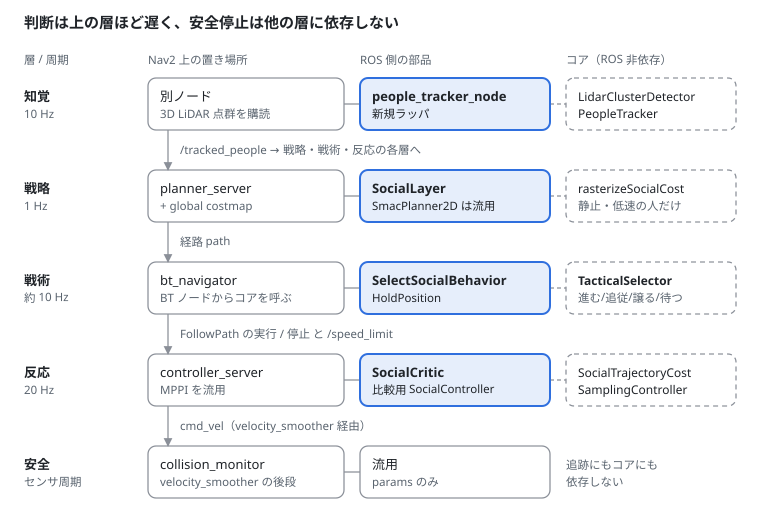

# social_nav

屋内公共空間向けのソーシャルナビゲーション(Nav2 / ROS 2 Jazzy、差動二輪・円形ロボット)。
歩行者を追跡し、戦略(costmap)・戦術(Behavior Tree)・反応(MPPI critic)の 3 層で人を避ける・譲る・待つ。
設計は [docs/design.md](docs/design.md)(案 D)。



データフローとパッケージの対応は [docs/design.md](docs/design.md) の 1〜2 章にある。

## 構成

| ディレクトリ | 内容 |
|---|---|
| `social_nav_core/` | ROS なしのコア(C++17)。人の追跡、社会的コスト、戦術選択、サンプリング制御、簡易シミュレータ |
| `ros2/social_nav_msgs`, `social_nav_ros_common` | `TrackedPeople` msg、型変換・購読ヘルパ |
| `ros2/social_nav_perception` | `people_tracker_node`(LiDAR 点群 → 追跡) |
| `ros2/social_nav_costmap_plugins` | `SocialLayer`(戦略層) |
| `ros2/social_nav_bt_nodes` | `SelectSocialBehavior`, `HoldPosition`(戦術層) |
| `ros2/social_nav_mppi_critics` | `SocialCritic`(反応層、MPPI 用) |
| `ros2/social_nav_controller` | `SocialController`(反応層、比較用) |
| `ros2/social_nav_bringup` | Nav2 パラメータ、BT XML、launch、スモークテスト |

## クイックスタート

```bash
docker compose -f docker/compose.yaml run --rm dev bash -lc '
  source /opt/ros/jazzy/setup.bash &&
  colcon build --base-paths src/social_nav --build-base build/colcon --install-base build/install &&
  colcon test  --base-paths src/social_nav --build-base build/colcon --install-base build/install;
  colcon test-result --test-result-base build/colcon'
```

```bash
ros2 launch social_nav_bringup social_nav.launch.py
```

既定は diff_drive / circle / 0.3 m / MPPI + SocialCritic。

## ドキュメント

- [docs/design.md](docs/design.md): 設計書(案 D)。層構成、データフロー、パッケージの対応
- [docs/sim_results.md](docs/sim_results.md): 簡易シミュレータの結果
- [docs/gallery.md](docs/gallery.md): 動作の様子(シミュレータと costmap の GIF)
- [docs/build.md](docs/build.md): ビルドとテストの詳細(コアだけのビルド、ci_local.sh、Docker)
- [docs/launch.md](docs/launch.md): launch 引数、TF と入力の前提、ロボット固有値の置き場
- [docs/verification.md](docs/verification.md): 検証済み範囲、既知の制限、未検証の項目
- [ros2/social_nav_bringup/README.md](ros2/social_nav_bringup/README.md): costmap の動画の作り方(PR 用デモ)

## ライセンス
このリポジトリは [Apache License 2.0](LICENSE) で公開する。著作権表示は [NOTICE](NOTICE) を参照。

