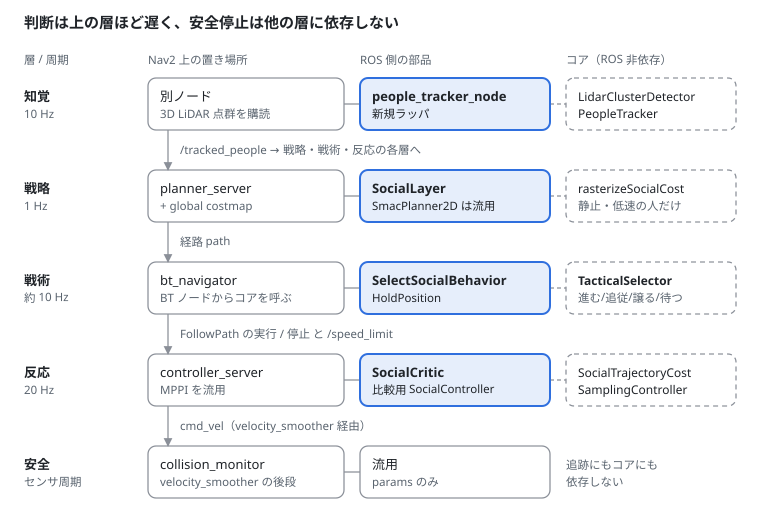
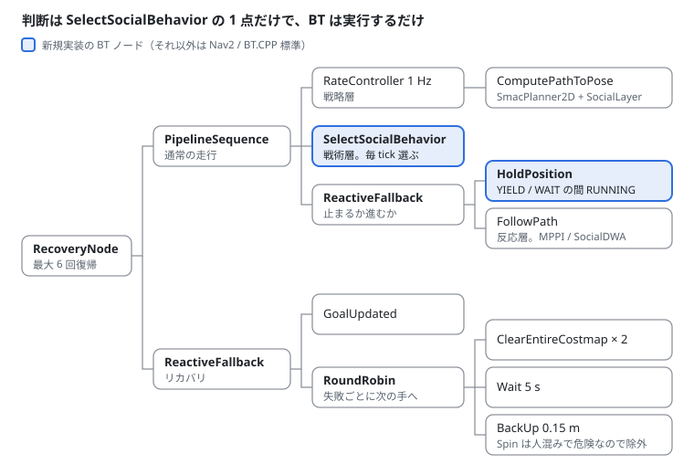

# social_nav 設計書(屋内公共空間向けソーシャルナビゲーション / Nav2)

**状態: 案 D(階層型)採用(2026-11-22、ユーザー決定)。実装待ち。MVP タスク 1 から着手する(7 章)。** 1〜10 章の詳細設計は案 D のもの。0 章の比較は判断の記録として残す。
**確定した前提(ユーザー回答)**: ROS 2 Jazzy + Nav2(BT.CPP v4)、差動二輪、円形フットプリント。MVP はこの組み合わせだけ実装する。他ディストリ・駆動方式・フットプリントへの拡張は 10 章の拡張ポイントで吸収し、API は MVP 時点から拡張を妨げない形にする。
**確定したリポジトリ構成**: 1 リポジトリ(`social_nav_core/` + `ros2/` + `docs/`)。将来の切り出し候補は bringup → core → msgs の順(7 章)。
**確定したコア API**: `MotionModel` / `Footprint` 抽象を含む形で確定(5.0)。MVP の実装は `DiffDriveModel` と `CircleFootprint` のみ。
本書の Nav2 API 記述は ROS 環境なしで書いている。「要確認」と書いた箇所は ROS 環境で最初に確かめること(8章)。
表の探し方: 設計案の比較 = 0.3、コア API の確定事項 = 5.0、評価指標一覧 = 6.3、案ごとの指標の期待傾向 = 6.4、図の素材 = 9 章、拡張ポイント = 10 章。

## 0. 設計案の比較と採用案(判断の記録)

### 0.1 4 案の定義
どの案でも共通: 人検出・追跡(LiDAR クラスタ + KF)と社会的コスト関数は非 ROS のコアに置く。3D 障害物は Nav2 同梱 `VoxelLayer`、プランナは `SmacPlanner2D` を流用。Nav2 に社会的コスト層は同梱されていないため `SocialLayer` はどの案でも新規。

| | 案 A: 既存 Nav2 最大流用 | 案 B: 全面独自 | 案 C: ハイブリッド | 案 D: 階層型(採用) |
|---|---|---|---|---|
| 判断の構造 | 階層なし。回避は全て controller のコスト | controller 中心。BT は補助 | 暗黙の 3 層。譲り・減速の判断順序は BT XML の構造に埋まる | **明示的な 3 層**。戦術判断はコアの状態機械 1 つに集約、BT はその結果を実行するだけ |
| 戦略(経路) | SmacPlanner2D + `SocialLayer`(global) | 同左 + local にも層 | A と同じ | A と同じ(拡張で混雑密度層・ゾーン選択) |
| 戦術(ふるまい) | なし(標準ツリー) | 新規 BT ノード、必要なら新規制御ノード | 新規 BT ノード 3 種(譲る / 密度減速 / 混雑判定)が個別に判断 | コア `TacticalSelector`(PROCEED / FOLLOW / YIELD / WAIT)+ 薄い BT ノード 2 種 |
| 反応(局所制御) | MPPI + 新規 `SocialCritic` | 新規 `SocialController` のみ | 既定 MPPI + `SocialCritic`、`SocialController` を比較用に同梱 | C と同じ + 独立した安全停止(`nav2_collision_monitor` 流用) |
| ROS なしシミュレータ | 部品検証が中心。走行には検証専用コントローラが要る | 実機と同じ controller と判断 | 判断ロジックをシミュレータ側で BT と同じ順序に並べ直す必要がある(二重管理) | 戦術層は実機と同一コードがそのまま動く。MPPI だけが対象外 |
| ROS パッケージ数 | 6 | 7 | 8 | 8 |

### 0.2 層と Nav2 の対応(案 D)
| 層 | 役割 | 周期 | Nav2 上の置き場所 | 実装 |
|---|---|---|---|---|
| 知覚(層の外) | 人の検出・追跡 | 10 Hz | **別ノード** `people_tracker_node` | 新規(コア + ラッパ) |
| 戦略層 | どこを通るか。静止・低速の人や混雑を避けた経路 | 1 Hz | **planner server**(`SmacPlanner2D`)+ global costmap の `SocialLayer`。再計画の起動は BT の `RateController` | プランナ流用、層は新規。拡張: 混雑密度層、ゾーン/経路グラフ選択 |
| 戦術層 | どうふるまうか。進む / 追従 / 譲る / 待機 の選択と速度上限 | BT tick(約 10 Hz) | **BT navigator**。BT ノード `SelectSocialBehavior` がコアの `TacticalSelector` を呼び、結果を blackboard と `/speed_limit` に出す | 新規(判断はコア、BT は実行) |
| 反応層 | どう動くか。予測込みの局所回避 | 20 Hz | **controller server**(MPPI + `SocialCritic`) | MPPI 流用、critic 新規 |
| 反応層(安全) | 近接時の減速・停止。上位層の誤りに依存しない | センサ周期 | **別ノード** `nav2_collision_monitor`(velocity_smoother の後段) | 流用(params のみ) |

層間のインターフェースは 3 つだけ: 戦略→戦術は `{path}`、戦術→反応は「FollowPath を走らせるか止めるか」と `/speed_limit`、全層→安全は cmd_vel の通過点。戦術層は controller の内部パラメータを書き換えない(層の独立性を保つため)。

### 0.3 比較表(設計観点)
評価は設計時点の見立てであり、測定結果ではない(◎ 良い / ○ 可 / △ 弱い / × 問題あり)。評価指標ごとの期待傾向は 6.4。

| 観点 | 案 A | 案 B | 案 C | 案 D |
|---|---|---|---|---|
| 実装コスト | ◎ 最小 | △ controller の実運用品質化が加わる | ○ A + BT ノード 3 種 + controller ラッパ | ○ C とほぼ同じ。状態機械が増え、BT ノードは 3→2 に減る。collision monitor は params のみ |
| 社会的性能 | △ 譲る・待つを表現できない | ○ 設計できるが軌道の表現力は MPPI より低い | ○ 譲り・減速はできる。追従は無く、判断同士の優先順位が XML の並びで決まる | ◎ ふるまいを明示的に選び、ヒステリシスと優先順位を 1 箇所で管理。追従を追加 |
| ROS 非依存検証 | △ 部品単位のみ | ◎ 検証したものがそのまま動く | ○ ロジックは同一だが実行順序は BT XML 側にあり検証外 | ◎ 戦術判断は遷移まで含めて単体テストとシミュレータで検証できる。検証外は MPPI と BT の配線だけ |
| 保守性 | ◎ 自前コード最少 | △ controller を全て自前で負う | ○ ふるまいを足すたびに BT ノードと XML とシミュレータの 3 箇所を直す | ○ ふるまいの追加はコアの状態機械に閉じる。ラッパ種類は C と同数 |
| リアルタイム性 | ○ MPPI 1500 バッチ × 人数 | ◎ 軽い | ○ A と同じ | ○ A と同じ。戦術層は人数に線形で無視できる。安全停止が制御周期に依存しない |
| 拡張性(ディストリ・駆動・形状) | ◎ ほぼ Nav2 の params で済む | △ 駆動方式・形状ごとに自前 controller の実装と検証が必須 | ○ 既定は params、比較用 controller だけコア拡張 | ○ C と同じ。BT ノードが v3/v4 共通 API だけで書けるほど薄い(10.1) |
| リスク | 待機・譲り・塞がれ時リカバリの要件を満たせない可能性が高い | 安全に直結する部分を実績のない自前実装に委ねる | 判断が複数 BT ノードに分散し、競合の検証が ROS 環境でしかできない | 状態機械と BT の役割が重複しやすい(規則で防ぐ)。状態のばたつき。初回 ROS 統合の確認項目は C と同程度に多い |

### 0.4 採用: 案 D(2026-11-22 ユーザー決定)
採用理由(設計時の推奨理由と同じ):
1. **判断の順序と遷移を BT XML からコアに移せる**。案 C の弱点は「譲り・減速・混雑待機の優先順位が XML の構造にあり、ROS なしでは検証できない」こと。必須要件(アルゴリズムはコアにあり ROS なしで検証)に照らすと、戦術判断を状態機械 1 つにまとめる案 D のほうが筋が良い。シミュレータ側で BT の順序を再現する二重管理も消える。
2. **追加コストが小さい**。案 C の譲り状態機械と密度減速を `TacticalSelector` に統合する形で、BT ノードはむしろ減る。安全停止は既存 `nav2_collision_monitor` の設定だけ。
3. **案 A が満たせない要件(待機、道を譲る、塞がれた時のリカバリ)を満たし、案 B の安全面の懸念(自前 controller が既定)を避ける**点は案 C と同じ。新規 `SocialController` は引き続き比較用で、案 B 相当への移行経路を残す。
4. **拡張余地を残しやすい**。既定の反応層が MPPI なので駆動方式・フットプリントの変更は主に params で済み、BT ノードが薄いので BT.CPP の版差を小さな互換ヘッダに閉じ込められる(10 章)。

案 D の代償: 概念(層、状態、遷移)が増える。状態機械と BT の二重構造は規律がないと崩れる。MVP の戦略層は案 C と同じ中身(プランナ + SocialLayer)で、「層として名前を付けた」以上の新機能は拡張になる。

### 0.5 不採用案との差分(記録。後で方針を変える場合の参考)
- **案 A**: `social_nav_controller` と `social_nav_bt_nodes` を作らない。BT は Nav2 標準ツリーから `Spin` を除いたもの。密度減速は `social_nav_perception` 内の小ノード `crowd_speed_node` にする。`SamplingController` は「検証専用」と明記してコアに残す。「道を譲る」は未達として残る。
- **案 B**: `social_nav_mppi_critics` を作らない。既定 `controller_id` を `SocialDWA` に。MVP に追加: ゴール近傍の姿勢合わせ、指令の平滑化、local costmap の `SocialLayer` 有効化。
- **案 C**: `TacticalSelector` を作らず、`YieldStateMachine` + BT ノード `YieldToPerson` / `SetCrowdSpeedLimit` / `IsCrowded` を個別に実装。FOLLOW は無し。それ以外は本書と同じ。

### 0.6 案によらない決定
| 項目 | 決定 | 捨てた案 |
|---|---|---|
| コア言語/依存 | C++17、標準ライブラリのみ(Eigen 不使用) | Eigen 依存(4x4 KF 程度なら手書きで足りる) |
| テスト | 依存なしの自前ミニテストヘッダ + ctest | GoogleTest(FetchContent はネットワーク必須、cmake 4.x と旧版の相性問題) |
| 人検出 MVP | LiDAR クラスタ + KF 追跡のみ。RGBD は障害物マーキングのみ | RGBD 融合を MVP に含める(検出器モデル依存が大きく非 ROS 検証不能) |
| 3D 障害物層 | Nav2 同梱 `VoxelLayer` | 新規 3D 層 / STVL(残像が問題になったら params 差し替え) |
| プランナ | `SmacPlanner2D` + global costmap の `SocialLayer` | 独自プランナ |
| 安全停止 | `nav2_collision_monitor` | 自前の安全停止ノード |
| シミュレータ | C++ 単一実行ファイル(コアを直接リンク)、Social Force | Python(numpy なし、bind が必要) |
| 運動モデル・形状 | コアは `MotionModel` / `Footprint` の抽象越しに扱う。MVP の実装は `DiffDriveModel` と `CircleFootprint` のみ | 差動・円形を各所に直書き(後からの拡張で API が壊れる) |
| リポジトリ | 1 リポジトリ(`social_nav_core/` + `ros2/` + `docs/`) | 最初から複数リポジトリ(API が固まる前に分けると変更が跨る) |



## 1. 全体構成とデータフロー(案 D)

```
3D LiDAR PointCloud2 ─┬─> [people_tracker_node] ──> /social_nav/tracked_people (TrackedPeople, frame=odom, 10Hz)
                      │      core: LidarClusterDetector → PeopleTracker         │
                      │                                         戦略 ───────────├─> global_costmap: SocialLayer ─> SmacPlanner2D ─> {path}
                      │                                         戦術 ───────────├─> bt_navigator: SelectSocialBehavior (core: TacticalSelector)
                      │                                                         │        ├─ {behavior} → HoldPosition が FollowPath を止める/通す
                      │                                                         │        └─ /speed_limit (nav2_msgs/SpeedLimit)
                      │                                         反応 ───────────└─> controller_server: MPPI + SocialCritic(既定)/ SocialController(比較用)
RGBD depth points ────┴─> local/global costmap: VoxelLayer → InflationLayer
cmd_vel_nav → velocity_smoother → collision_monitor(安全停止、LiDAR 直結)→ cmd_vel
```
図に起こすための部品・矢印の一覧は 9 章。

- 追跡座標系は `odom`(連続で飛ばない)。利用側が自分の global_frame と違えば TF で変換する。
- 人の「身体」は VoxelLayer が致死コストで扱う。SocialLayer / SocialCritic は**非致死の快適性コスト**のみを足す(上限 `max_cost`=200 < 253)。他に道がなければパーソナルスペースを通る経路が残る。
- 人の扱いの分担: 戦略層 = SocialLayer(静止/低速の人だけ)、反応層 = controller(時間方向の予測込み)。local costmap に SocialLayer を入れると MPPI の CostCritic と二重計上になるので入れない。
- 追跡が 0.5 s 以上途絶えたら各層は人情報を無視する(戦術は PROCEED 固定、反応は純粋な障害物回避に縮退)。安全停止は追跡に依存しない。

### 人検出の範囲
- **MVP**: LiDAR 点群を base_link で高さ帯 0.3–1.5 m に絞って 2D 投影 → 0.1 m グリッド連結成分クラスタ → 幅 0.2–0.8 m・点数下限でゲート → 等速 KF 追跡。誤検出抑制は (a) static map の占有セル近傍 0.2 m のクラスタ除外(ラッパ側、`/map` 購読)、(b) 確定条件「3 回連続ヒット」。
- **拡張**: RGBD 人検出(2D 検出器 + 深度で 3D 位置)を `Detection{source=RGBD}` として同じ `PeopleTracker::update` に入れる検出レベル融合。RGBD で確認された track は `confidence` を上げ、前方 FOV 内で未確認のまま静止している track は下げる。コア API は MVP 時点でこの入力を受けられる形にしておく。
- **対象外**: 姿勢・視線・グループ推定、再同定。

## 2. ディレクトリ / パッケージ構成

1 リポジトリ構成(確定)。切り出しの見通しは 7 章「リポジトリ構成」。

```
social_nav/
  social_nav_core/            # 非ROS。CMake 単体プロジェクト(package.xml は build_type=cmake で colcon からも可)
    CMakeLists.txt            # cmake_minimum_required(3.16), C++17, -Wall -Wextra, install(EXPORT) で social_nav_coreConfig.cmake
    include/social_nav_core/  # types.hpp motion_model.hpp footprint.hpp proxemics.hpp trajectory_cost.hpp grid_rasterizer.hpp
                              # cluster_detector.hpp people_tracker.hpp crowd_analyzer.hpp tactical_selector.hpp sampling_controller.hpp
    src/
    test/                     # mini_test.hpp, test_*.cpp(1ファイル=1実行ファイル、ctest 登録)
    sim/                      # social_force.hpp/.cpp scenarios.cpp metrics.cpp main.cpp → social_nav_sim
    tools/plot_svg.py         # 標準ライブラリのみ。CSV → SVG(任意)
  ros2/
    social_nav_msgs/          # TrackedPerson.msg, TrackedPeople.msg
    social_nav_ros_common/    # ヘッダのみ: msg <-> core 型変換、鮮度チェック付き購読ヘルパ、robot_model_params.hpp(10.4)
    social_nav_perception/    # people_tracker_node(+ 拡張: rgbd_person_detector_node)
    social_nav_costmap_plugins/  # 戦略層: SocialLayer
    social_nav_bt_nodes/         # 戦術層: SelectSocialBehavior, HoldPosition。版差は include/.../bt_compat.hpp に局所化
    social_nav_mppi_critics/     # 反応層: SocialCritic(MPPI 本体は流用)。版差は src/critic_data_adapter.hpp に局所化
    social_nav_controller/       # 反応層(比較用): SocialController(コアの SamplingController のラッパ)
    social_nav_bringup/          # params/nav2_social_params.yaml(collision_monitor 含む), behavior_trees/navigate_social.xml, launch/
  docs/                       # 設計書の公開版、図(9 章・10.5 の素材から起こす)、評価結果の記録
```

規則:
- `social_nav_core` は ROS ヘッダを一切 include しない。ラッパは「購読 → 型変換 → コア呼び出し → 書き戻し」だけ。
- **ふるまいの判断(いつ譲るか、いつ待つか、速度上限)は `TacticalSelector` だけが行う**。BT XML に判断条件(距離や時間の閾値)を書かない。BT は選ばれたふるまいの実行と、Nav2 標準のリカバリだけを担う。
- **ディストリ依存のコードは各パッケージの互換ヘッダ 1 つに閉じ込める**(10.1)。それ以外のファイルに `#if` を書かない。
- **コア内でロボットの半径・差動二輪の運動学を直接書かない**。必ず `Footprint` / `MotionModel` 経由にする(10.2, 10.3)。
- **依存の向きは `bringup → 各 ROS パッケージ → ros_common → {msgs, core}` の一方向**。`social_nav_core` と `social_nav_msgs` は互いに依存しない。コアをリポジトリ内の相対パス(`../social_nav_core` の `add_subdirectory` 等)で参照せず、必ず `find_package(social_nav_core)` で使う(将来の切り出しを妨げないため)。

メッセージ(`people_msgs` は配布状況が不確かなので自前定義):
```
# TrackedPerson.msg
uint32 id
geometry_msgs/Point position      # z=0
geometry_msgs/Vector3 velocity
float64[4] position_covariance    # xx, xy, yx, yy
float32 radius
float32 confidence
# TrackedPeople.msg
std_msgs/Header header
TrackedPerson[] people
```

## 3. Nav2 プラグイン

### 3.0 プラグイン単位の新規/流用の判断
| 対象 | 判定 |
|---|---|
| 社会的コスト層 | **新規** `SocialLayer`。描画はコアで単体テスト可。非致死コストのみで安全性に関与しない。既存 proxemic layer 移植版は保守状況が不確かでロジックが ROS 側に残るため不採用 |
| 3D 障害物層 | **流用** `VoxelLayer`。マーキング/クリアリングは衝突に直結するので自作しない。人の点群を障害物から除くフィルタ層も作らない(追跡誤りが衝突リスクになる) |
| controller | **既定は MPPI 流用 + 新規 critic**。動力学制約・フットプリント衝突判定・平滑化は MPPI の実績に任せる。**新規 `SocialController` は比較用に同梱**(シミュレータで検証したものがそのまま動く)。既定への昇格条件: 同一シナリオで衝突 0 かつ侵入時間・到達時間が MPPI 構成と同等以上 |
| BT ノード | **新規 leaf 2 種 + 新規ツリー、制御ノードは既存**。既存ノードだけでは人を見た判断ができない(SpeedFilter/KeepoutFilter は静的マスク前提)。新規制御ノードは tick/halt 意味論を ROS なしで検証できないので作らない |
| 戦術判断の置き場所 | **BT navigator 内**(BT ノードからコアを呼ぶ)。別ノードにして topic で BT に渡す案は、遅延と同期ずれが増え、FollowPath の halt を結局 BT で行う必要があるため不採用。controller 内部に埋める案は、意図的な停止を progress checker が立ち往生と誤認するため不採用 |
| 安全停止 | **流用** `nav2_collision_monitor` |

方針: 新規実装は「間違えても不快になるだけで衝突しない部分」に寄せ、衝突に直結する部分は既存実装に任せる。

### 3.1 戦略層: costmap layer と planner
| 層 | クラス | 用途 |
|---|---|---|
| static | `nav2_costmap_2d::StaticLayer` | global のみ |
| voxel | `nav2_costmap_2d::VoxelLayer` | LiDAR(marking+clearing, 0.1–1.8 m)と RGBD(marking+clearing, obstacle_max_range 3.0)の 2 ソース。global/local 両方 |
| social | `social_nav_costmap_plugins::SocialLayer` : `nav2_costmap_2d::Layer` | **global のみ有効**。local は `enabled: false` で定義だけ置く |
| inflation | `nav2_costmap_2d::InflationLayer` | 両方 |

順序: `[static, voxel, inflation, social]`。SocialLayer は `max(既存, social)` で書き、`NO_INFORMATION` と致死セルは触らない。

SocialLayer の override: `onInitialize()`, `updateBounds(...)`, `updateCosts(Costmap2D&, min_i, min_j, max_i, max_j)`, `reset()`, `isClearable()`(false)。`updateBounds` では前回描いた AABB と今回の AABB の和を広げる(前回分を消すため)。描画はコアの `rasterizeSocialCost` を `master_grid.getCharMap()` に直接適用。SocialLayer は人の周りのコストだけを描くので、ロボットの形状・駆動方式に依存しない。

パラメータ: `enabled`, `people_topic`(/social_nav/tracked_people), `max_cost`(200), `sigma`(0.45), `velocity_gain`(0.4), `rear_ratio`(0.6), `cutoff_cost`(0.05 相当で打ち切り), `max_speed_for_layer`(0.3 m/s。これより速い人は描かない=再計画の振動防止), `prediction_time`(0.0), `stale_timeout`(0.5), `min_confidence`(0.3)。

planner: `nav2_smac_planner::SmacPlanner2D`(差動・円形の MVP 構成)。`tolerance: 0.25`。再計画は BT で 1 Hz。駆動方式・形状を変える場合の差し替えは 10.2, 10.3。

戦略層の拡張(MVP 外): 数十秒の時間平均をとる混雑密度層(`CrowdDensityLayer`、同じ rasterizer を流用)、ゾーン/経路グラフによる通路選択。

### 3.2 戦術層: BT ノード(`social_nav_bt_nodes`)
`BT_REGISTER_NODES` で登録し、bt_navigator の `plugin_lib_names` に `social_nav_bt_nodes` を追加。ノード取得は `config().blackboard->get<rclcpp::Node::SharedPtr>("node")`。

| ノード | 継承 | ポート | 動作 |
|---|---|---|---|
| `SelectSocialBehavior` | `BT::SyncActionNode` | in: `path`, `people_topic`、out: `behavior`(文字列 `PROCEED`/`FOLLOW`/`YIELD`/`WAIT`) | ロボット姿勢(TF)・最新 people・path をコアの `TacticalSelector::step` に渡す。結果の `behavior` を blackboard に書き、`speed_ratio` を `/speed_limit` に `nav2_msgs/msg/SpeedLimit{percentage=true}` で publish(変化 5% 未満は再送しない)。常に SUCCESS。people が鮮度切れなら `PROCEED`・100% |
| `HoldPosition` | `BT::StatefulActionNode` | in: `behavior` | `behavior` が `YIELD` か `WAIT` の間 RUNNING、それ以外は FAILURE。SUCCESS は返さない。判断はしない |

`TacticalSelector` のパラメータ(5 章 `TacticalParams`)は bt_navigator ノードの `social_behavior.*` として宣言し、`SelectSocialBehavior` が読む。XML には書かない。
BT ノードが使う BT.CPP の機能は v3/v4 共通のもの(`providedPorts`, `getInput`, `setOutput`, `tick`, `onStart`/`onRunning`/`onHalted`、文字列ポート)に限る。v4 専用機能(スクリプト、pre/post condition、enum ポート)は使わない(10.1)。

### 3.3 反応層: MPPI + SocialCritic(既定)
```yaml
controller_server:
  ros__parameters:
    controller_plugins: ["FollowPath", "SocialDWA"]
    FollowPath: { plugin: "nav2_mppi_controller::MPPIController", ... }      # 既定。BT は controller_id="FollowPath"
    SocialDWA:  { plugin: "social_nav_controller::SocialController", ... }   # 比較用。BT XML の controller_id を変えるだけで切替
```
- クラス: `mppi::critics::SocialCritic` : `mppi::critics::CriticFunction`。override は `initialize()` と `score(CriticData & data)`。
- **名前空間は `mppi::critics` 固定**(MPPI の CriticManager が yaml の critic 名に `mppi::critics::` を前置して pluginlib ロードするため。要確認)。pluginlib XML の `base_class_type="mppi::critics::CriticFunction"`。
- `initialize()`: `parent_.lock()` のノードに TrackedPeople 購読を作る。パラメータは `parameters_handler_->getParamGetter(name_)`。フットプリントは 10.4 の共通パラメータから `Footprint` を生成する。
- `score()`: 最新 people を mutex 下でコピー → `SocialTrajectoryCost::prepare(...)` → 各バッチ行を `TrajectoryView`(x, y, yaw)でコアに渡し `data.costs(i) += weight * cost`。people の frame が costmap の global_frame と違えば `costmap_ros_->getTfBuffer()` で変換。
- Jazzy は `data.trajectories.x/y/yaws` が xtensor(行優先)、Kilted 以降は Eigen(列優先)。差は `TrajectoryView` の `stride` で吸収し、型に触るコードは `critic_data_adapter.hpp` の `makeView(data, i)` と `addCost(data, i, c)` に閉じ込める(10.1)。
- SocialCritic は軌道の位置と向きだけを見るので、MPPI の `motion_model`(DiffDrive / Omni / Ackermann)に依存しない。
- パラメータ: `enabled`, `cost_weight`(初期 5.0、要チューニング), `cost_power`(1), `people_topic`, `sigma`, `velocity_gain`, `rear_ratio`, `collision_margin`(0.1), `collision_cost`(1000 相当), `time_decay_tau`(2.0 s), `step_subsample`(2), `max_range`(6.0), `stale_timeout`, `min_confidence`。
- 併用 critic: `ConstraintCritic, CostCritic, GoalCritic, GoalAngleCritic, PathAlignCritic, PathFollowCritic, PathAngleCritic, PreferForwardCritic, SocialCritic`。MPPI 本体: `time_steps: 56, model_dt: 0.05, batch_size: 1500, vx_max: 0.8, motion_model: DiffDrive`。

### 3.4 反応層(比較用): SocialController
- クラス: `social_nav_controller::SocialController` : `nav2_core::Controller`。pluginlib の `base_class_type="nav2_core::Controller"`。
- override: `configure(parent, name, tf, costmap_ros)`, `cleanup()`, `activate()`, `deactivate()`, `setPlan(const nav_msgs::msg::Path&)`, `computeVelocityCommands(pose, velocity, goal_checker)`, `setSpeedLimit(speed_limit, percentage)`(シグネチャ要確認)。
- `configure`: パラメータ `motion_model` と 10.4 の共通フットプリントパラメータから `makeMotionModel` / `makeFootprint` でコアのオブジェクトを作り `SamplingController` に渡す。
- `computeVelocityCommands` の手順(ラッパが持つのはここまで。評価と選択はコア):
  1. グローバル経路を costmap の global_frame(odom)へ変換し、ロボット最近傍点より手前を刈り、`path_lookahead`(3.0 m)先までを `std::vector<Pose2D>` にする
  2. `ObstacleCostFn` を local costmap から作る(範囲外と `NO_INFORMATION` は 1.0=衝突扱い、それ以外は cost/253)
  3. 最新 people(鮮度切れなら空)と速度制限比を渡して `SamplingController::compute` を呼ぶ
  4. 全候補が衝突ならコアは停止指令を返す。それが `stuck_timeout`(2.0 s)続いたら例外を投げて BT のリカバリに渡す
- パラメータ: `people_topic`, `stale_timeout`, `path_lookahead`, `stuck_timeout`, `motion_model`(`diff_drive`。MVP ではこれ以外は configure で失敗させる)と、`ControllerParams` の全項目(5章)を同名で公開。
- 制限(MVP): `DiffDriveModel` と `CircleFootprint` のみ実装。ゴール近傍の最終姿勢合わせは `w_goal` 任せで専用処理なし。

### 3.5 反応層(安全): collision monitor
`nav2_collision_monitor` を velocity_smoother の後段に置く(`cmd_vel_in_topic: cmd_vel_smoothed`, `cmd_vel_out_topic: cmd_vel`)。観測源は LiDAR の PointCloud2(`min_height: 0.1, max_height: 1.5`)。ポリゴン 2 つ: 停止(半径 0.45 m の円、`action_type: stop`)と減速(半径 0.8 m、`action_type: slowdown`, `slowdown_ratio: 0.4`)。パラメータ名は要確認。追跡・costmap・BT のいずれにも依存させない。

注記(接触率と後退、sim との差と後退の扱い):
- sim の安全停止(クリアランス 0.15 m 未満で強制停止)は人の動きを予測して止まるが、collision_monitor は観測点に対する静的な円(StopPolygon 0.45 m)で判定する。減速の PolygonSlow は sim にない。どちらも後退の指令(v < 0)を止める。差を揃えるかは別 issue。
- 決定 3: M1a の基準は、判定 21–120 の social(既定の歩行者モデル sfm2)で corridor_oncoming 31 以下、crossing 0、crowd 159 以下(回帰の上限。ほかのシナリオは 0)。M1a = 0 はやめた(接触率と後退で 10/2/410 にし、sfm2 への切り替えで歩行者モデルを sfm2 に替えたので上限を sfm2 の値に変更。ユーザー決定、2026-11-22)。理由: 大半は停止直後に人に当たられる接触で、0.5 s 前に 92% で全候補に予測接触があり、後退(`--v-min`)は M1 合計を増やした。M1a から M1b への移動(停止して接触が「停止 1.0 s 以上」に移ること)を改善に数えない規則は残す。改善と呼ぶ条件は、全 5 構成 × 全 6 シナリオで M1 合計が増えず、かつ M1a の減少が M1b の増加を上回ること(移動件数 = min(−ΔM1a, max(0, ΔM1b)) を併記)。測定は docs/sim_results.md の接触率と後退節と sfm2 への切り替え節。
- 安全停止の整合の決定 3 点(sim と collision_monitor の整合。測定は docs/sim_results.md の「安全停止の整合」の節):
  1. 整合の採否: **採らない(既定は現行の predictive のまま)**。ROS の collision_monitor を正とし、sim を寄せる 2 候補を選定 1–20 と専用範囲 521–620 で測った。K2 `--safety-mode cm`(外形間 0.15 m 未満で無条件停止、0.5 m 未満で指令を 0.4 倍)と K1 `cm_stop`(停止のみ)。どちらも crowd の M1a/M1 合計が増え(1–20 の social crowd M1 合計: K0 19、K1 29、K2 59)、段の基準を通らなかった。フラグは残す(既定では使わない)。判定 21–120 は回していない。**既知の差**: sim の既定は人の 1 刻み先を予測し、縮むときだけ止める。CM は現在の距離だけを静的な円で見て、向きも縮みも見ずに止まり、0.5 m 未満では減速する。このため実機の CM は sim より止まりやすく、sim は実機より甘い可能性がある。
  2. 離れる向きの指令: ROS 側は変えない(離れる向きの指令を通す案は、CM の action_type の挙動を Nav2 のソースで未確認のため別 issue)。cm / cm_stop は離れる向きでも止まる(CM の円は向きを見ないという解釈。yaml の字義どおり)。
  3. 後方センサ: sim では写さない。sim は全周の人を真値で見るが、実機の観測は LiDAR の点群で、後方の死角・min_points 4・高さ範囲(0.1〜1.5 m)の影響を受ける。これらは sim にない。
- 定数の一致: sim の定数(`social_nav_core/sim/safety.hpp` の 0.15 / 0.5 / 0.4)は launch が与える半径(robot_radius + 0.15、+ 0.5)と yaml の `slowdown_ratio: 0.4` の写しで、`test_bringup_files.py` が一致を検査する。パラメータ名と slowdown の後退・角速度への効き方は未確認(cm は yaml の字義どおりに全成分を 0.4 倍)。

## 4. Behavior Tree(`navigate_social.xml` 骨子)




```xml
<root BTCPP_format="4" main_tree_to_execute="MainTree">
  <BehaviorTree ID="MainTree">
    <RecoveryNode number_of_retries="6" name="NavigateRecovery">
      <PipelineSequence name="NavigateWithSocial">
        <!-- 戦略層: 1 Hz 再計画 -->
        <RateController hz="1.0">
          <RecoveryNode number_of_retries="1" name="ComputePath">
            <ComputePathToPose goal="{goal}" path="{path}" planner_id="GridBased"/>
            <ClearEntireCostmap name="ClearGlobal" service_name="global_costmap/clear_entirely_global_costmap"/>
          </RecoveryNode>
        </RateController>
        <!-- 戦術層: ふるまい選択(判断はコア)。毎 tick 再評価 -->
        <SelectSocialBehavior path="{path}" behavior="{behavior}"/>
        <!-- 戦術→反応: YIELD/WAIT の間は FollowPath を halt -->
        <ReactiveFallback name="HoldOrFollow">
          <HoldPosition behavior="{behavior}"/>
          <RecoveryNode number_of_retries="1" name="FollowPath">
            <FollowPath path="{path}" controller_id="FollowPath"/>
            <ClearEntireCostmap name="ClearLocal" service_name="local_costmap/clear_entirely_local_costmap"/>
          </RecoveryNode>
        </ReactiveFallback>
      </PipelineSequence>
      <ReactiveFallback name="RecoveryFallback">
        <GoalUpdated/>
        <RoundRobin name="RecoveryActions">
          <Sequence name="ClearAll">
            <ClearEntireCostmap name="ClearLocal2" service_name="local_costmap/clear_entirely_local_costmap"/>
            <ClearEntireCostmap name="ClearGlobal2" service_name="global_costmap/clear_entirely_global_costmap"/>
          </Sequence>
          <Wait wait_duration="5.0"/>
          <BackUp backup_dist="0.15" backup_speed="0.05"/>
        </RoundRobin>
      </ReactiveFallback>
    </RecoveryNode>
  </BehaviorTree>
</root>
```
ツリーの図用の構造(ノード種別・tick の流れ)は 9.4。

ふるまいと実現手段:
| ふるまい | 選ばれる条件(コア、5 章) | 実現 |
|---|---|---|
| PROCEED | 既定 | FollowPath 実行。速度上限は周囲密度から(混雑時の減速) |
| FOLLOW | 経路前方に同方向へ歩く人がいる | FollowPath 実行。速度上限を前の人の速度に合わせる(背後に詰めない)。相手が遅すぎる場合は PROCEED に戻り、MPPI と再計画が追い越す |
| YIELD | 経路前方を低速/静止の人が塞いでいる | FollowPath を halt して停止。上限時間で打ち切り、cooldown 中は PROCEED(静止した人は SocialLayer に載るので再計画で迂回) |
| WAIT | 周囲密度が待機閾値超 | 停止。密度が下がるか上限時間で PROCEED(最低速度比) |

設計意図:
- `HoldPosition` が RUNNING の間、ReactiveFallback が後続の FollowPath を halt する(=制御キャンセルで停止)。PipelineSequence の子に `Wait` を直接置く案は不可(先行子が RUNNING でも後続の FollowPath が tick され続け、止まらない)。
- 意図した停止(YIELD/WAIT)中は FollowPath が動いていないので progress checker は失敗しない。迂回もできず進捗が止まった時だけ FollowPath が失敗し、リカバリ分岐に入る。
- リカバリは Nav2 標準の形。`Spin` は人混みで危険かつ不快なので除外(その場旋回できない Ackermann にもそのまま使える)。BackUp は 0.15 m に制限。
- controller の切替は `FollowPath` ノードの `controller_id` を `SocialDWA` にするだけ。

## 5. コアライブラリ API(namespace `social_nav`)

### 5.0 確定事項(API の最終形)
**決定: `MotionModel` / `Footprint` 抽象を MVP のコア API に含める。** 実装は `DiffDriveModel` と `CircleFootprint` の 1 つずつだけ。以下のシグネチャで確定とし、タスク 1 以降はこれを変えない(変える必要が出たら実装を止めて報告する)。

理由:
- 抽象を後から入れると `SocialTrajectoryCost` と `SamplingController` のコンストラクタ、`SocialCostParams`(`robot_radius` の有無)、M1 / M2 の定義、シミュレータ、ラッパ 2 種が同時に変わる。最初に入れるコストは純粋仮想クラス 2 つ・ファクトリ 2 つ・実装 2 つ(各 30〜50 行)で、タスク 1 に収まる。
- 仮想呼び出しの負荷は問題にならない。`SocialTrajectoryCost::score` の熱いループは外接円での事前判定で大半を弾き、`clearance` を呼ぶのは近接時だけ。`MotionModel` の呼び出しは `SamplingController`(候補 189 本 × 30 ステップ)だけで、MPPI 経路には現れない。
- 捨てた代替: (a) 抽象なし(`robot_radius` と差動の式を直書き)は拡張時に API が壊れる。(b) テンプレート引数での静的多態は、ラッパが実行時パラメータで種類を選べず、ヘッダに実装が漏れる。

MVP で入れる最小形(これ以上は作らない):
| 要素 | MVP で入れる | MVP で入れない |
|---|---|---|
| `MotionModel` | 抽象クラス(4 メソッド)、`DiffDriveModel`、`makeMotionModel("diff_drive")` | `OmniModel`、`AckermannModel`(ファクトリが `std::invalid_argument`) |
| `Footprint` | 抽象クラス(4 メソッド)、`CircleFootprint`、`makeFootprint({type="circle"})` | `PolygonFootprint`(同上)。`FootprintSpec.points` はフィールドだけ持つ |
| 型・パラメータ | `Twist2D.vy`、`VelocityLimits` の `vy_max` / `acc_vy` / `min_turning_radius` / `v_min`、`SampleSpec.vy_samples`、`TrajectoryView.yaw`(nullptr 可) | これらを使う分岐(`DiffDriveModel` は vy=0 固定、`min_turning_radius` は無視) |
| 注入 | `SocialTrajectoryCost(params, footprint)`、`SamplingController(params, motion_model, footprint)` を `std::shared_ptr<const ...>` で受ける | 既定引数や内部生成(必ず呼び出し側が渡す。直書きの逃げ道を作らない) |
| テスト | 偽 `MotionModel` を注入するテスト 1 本、ファクトリの例外テスト | 未実装モデルのテスト |

抽象を使う箇所と使わない箇所:
| コンポーネント | `MotionModel` | `Footprint` |
|---|---|---|
| `SamplingController` | 使う(候補生成とロールアウト) | 使う(障害物照会点) |
| `SocialTrajectoryCost` | 使わない(軌道を受け取るだけ) | 使う(人との近接判定) |
| シミュレータ(ロボット積分、M1 / M2) | 使う | 使う |
| `TacticalSelector`、`crowd_analyzer`、`grid_rasterizer`、`PeopleTracker`、`LidarClusterDetector`、proxemics | 使わない | 使わない(`corridor.half_width` はパラメータ) |

### 5.1 シグネチャ

```cpp
// types.hpp
struct Vec2 { double x{0}, y{0}; };
struct Point3 { float x, y, z; };
struct Pose2D { double x{0}, y{0}, theta{0}; };
struct Twist2D { double vx{0}, vy{0}, wz{0}; };       // vy は差動二輪では常に 0。Omni 用に最初から持つ
struct Cov2 { double xx{0}, xy{0}, yy{0}; };
struct Agent { uint32_t id; Vec2 pos; Vec2 vel; Cov2 pos_cov; double radius{0.3}; double confidence{1.0}; };
struct TrackedPeople { double stamp{0}; std::string frame_id; std::vector<Agent> agents; };
Agent predictConstantVelocity(const Agent& a, double dt);   // 共分散は dt に応じて膨らませる

// motion_model.hpp — 駆動方式の差し替え点(10.2)
struct VelocityLimits { double v_min{0.0}, v_max{0.8}, vy_max{0.0}, w_max{1.5};
                        double acc_v{1.0}, acc_vy{0.0}, acc_w{3.0}; double min_turning_radius{0.0}; };
struct SampleSpec { int v_samples{9}, vy_samples{1}, w_samples{21}; };
class MotionModel {
 public:
  virtual ~MotionModel() = default;
  virtual const char* name() const = 0;
  virtual Pose2D integrate(const Pose2D& pose, const Twist2D& cmd, double dt) const = 0;
  // 現在速度から dt 後に到達可能で、limits とモデル固有の拘束を満たす指令候補を out に追加する
  virtual void sampleCommands(const Twist2D& current, const VelocityLimits& limits, const SampleSpec& spec,
                              double dt, std::vector<Twist2D>& out) const = 0;
  virtual bool canRotateInPlace() const = 0;
};
class DiffDriveModel final : public MotionModel { /* vy=0。MVP で実装するのはこれだけ */ };
std::unique_ptr<MotionModel> makeMotionModel(const std::string& type);   // "diff_drive"。未実装の種類は std::invalid_argument

// footprint.hpp — 形状の差し替え点(10.3)
class Footprint {
 public:
  virtual ~Footprint() = default;
  virtual double inscribedRadius() const = 0;
  virtual double circumscribedRadius() const = 0;
  // ロボット外形から点 p までの距離。内部は負
  virtual double clearance(const Pose2D& robot, Vec2 p) const = 0;
  // 障害物コストを照会する点(ワールド座標)を out に追加する。円は中心 1 点
  virtual void costQueryPoints(const Pose2D& robot, std::vector<Vec2>& out) const = 0;
};
class CircleFootprint final : public Footprint { public: explicit CircleFootprint(double radius); /* MVP */ };
struct FootprintSpec { std::string type{"circle"}; double radius{0.3}; std::vector<Vec2> points; };
std::unique_ptr<Footprint> makeFootprint(const FootprintSpec& spec);     // "circle"。"polygon" は未実装で std::invalid_argument

// proxemics.hpp
struct ProxemicsParams { double sigma{0.45}; double velocity_gain{0.4}; double rear_ratio{0.6};
                         double static_speed{0.2}; double cutoff{0.05}; };
double proxemicCost(const Agent& a, Vec2 p, const ProxemicsParams& prm);     // [0,1]
double proxemicRadius(const Agent& a, const ProxemicsParams& prm);           // cost<cutoff となる最大距離
```
`proxemicCost` の定義: 人の進行方向を x' 軸とする局所座標 (dx, dy) で `exp(-(dx²/(2σx²) + dy²/(2σy²)))`。
`σy = sigma`、前方(dx>0) `σx = sigma + velocity_gain*|v|`、後方 `σx = sigma*rear_ratio`。`|v| < static_speed` なら等方(σx=σy=sigma)。

```cpp
// trajectory_cost.hpp  — 反応層: SocialCritic と SamplingController が共用する唯一の社会的コスト
// yaw は nullptr 可(その場合 clearance は向き 0 で評価。円形では結果が変わらない)
struct TrajectoryView { const float* x; const float* y; const float* yaw; std::size_t n; std::ptrdiff_t stride; };
struct SocialCostParams { ProxemicsParams prox; double collision_margin{0.1};
                          double collision_cost{1000.0}; double time_decay_tau{2.0};
                          int step_subsample{2}; double max_range{6.0}; double min_confidence{0.3}; };
class SocialTrajectoryCost {
 public:
  SocialTrajectoryCost(SocialCostParams p, std::shared_ptr<const Footprint> footprint);
  // ロボット位置から max_range 内の人だけ残し、各評価ステップの予測位置を前計算する
  void prepare(const TrackedPeople& people, Vec2 robot_pos, double t_offset, double dt, std::size_t n_steps);
  double score(const TrajectoryView& traj) const;   // 小さいほど良い。prepare 済みが前提。スレッド安全(const)
  bool empty() const;                               // 対象の人がいなければ true(呼び出し側で早期 return)
};
```
`score` = Σ_k exp(-t_k/τ) · [ Σ_人 proxemicCost(予測人_k, p_k) + (footprint.clearance(pose_k, 人位置) < 人radius + margin なら collision_cost) ]。
近接判定は 2 段: 中心間距離 > `circumscribedRadius` + 人radius + margin なら `clearance` を呼ばない(多角形でも熱いループを軽く保つため)。快適性コスト `proxemicCost` はロボット中心で評価する。

```cpp
// grid_rasterizer.hpp — 戦略層: SocialLayer の中身(ロボット形状に依存しない)
struct GridSpec { double origin_x, origin_y, resolution; unsigned size_x, size_y; };   // index = y*size_x + x
struct CellWindow { int min_i, min_j, max_i, max_j; };
struct Aabb { double min_x, min_y, max_x, max_y; bool valid{false}; };
struct RasterParams { ProxemicsParams prox; uint8_t max_cost{200}; double max_speed{0.3};
                      double prediction_time{0.0}; double min_confidence{0.3}; };
Aabb socialBounds(const TrackedPeople&, const RasterParams&);
void rasterizeSocialCost(const GridSpec&, const CellWindow&, const TrackedPeople&, const RasterParams&,
                         uint8_t* cells);   // max マージ。値 253 以上と 255 のセルは変更しない

// cluster_detector.hpp / people_tracker.hpp — 知覚
enum class DetectionSource { LIDAR, RGBD };
struct Detection { Vec2 pos; Cov2 cov; double radius; DetectionSource source; };
struct ClusterParams { double z_min{0.3}, z_max{1.5}, cell{0.1}, min_width{0.2}, max_width{0.8},
                       max_range{10.0}; int min_points{5}; };
class LidarClusterDetector {
 public:
  explicit LidarClusterDetector(ClusterParams);
  std::vector<Detection> detect(const std::vector<Point3>& pts_base, const Pose2D& base_in_odom) const;
};
struct TrackerParams { double gate_mahalanobis{3.0}; double process_noise_acc{1.0}; int confirm_hits{5};
                       double delete_after{1.0}; double max_speed{3.0};
                       double init_vel_sigma{1.0}; };   // 新規 track の初期速度 σ [m/s]
class PeopleTracker {
 public:
  explicit PeopleTracker(TrackerParams);
  void update(const std::vector<Detection>& dets, double stamp);   // 予測→最小コスト割り当て(被約費用 + 多始点 Dijkstra の逐次最短増加路法)による対応(コスト m2+ln det S、ゲート内)→未対応の確定 track と検出を m2≤25 で再対応→KF更新→生成/削除(track/検出が 128 超は貪欲にフォールバック)
  TrackedPeople confirmed(const std::string& frame_id) const;
};
```
KF 状態は [x, y, vx, vy] の等速モデル。4x4 行列演算は `std::array` で手書き(観測は 2 次元なので逆行列は 2x2)。

```cpp
// crowd_analyzer.hpp — 戦術層の部品(状態を持たない幾何計算)
double crowdDensity(const TrackedPeople&, Vec2 center, double radius);             // 人/m²
double speedLimitRatio(double density, double low, double high, double min_ratio); // [min_ratio, 1]
struct CorridorParams { double lookahead{2.5}; double half_width{0.5}; };          // half_width の目安 = circumscribedRadius + 0.2
struct PersonOnPath { uint32_t id; double dist_along; double speed_along; double speed; };  // speed_along: 経路接線方向成分(同方向が正)
std::vector<PersonOnPath> peopleOnPath(const std::vector<Pose2D>& path, const Pose2D& robot,
                                       const TrackedPeople&, const CorridorParams&);        // 近い順

// tactical_selector.hpp — 戦術層の本体。BT ノードとシミュレータが同じものを使う
enum class Behavior { PROCEED, FOLLOW, YIELD, WAIT };
const char* toString(Behavior);
struct TacticalParams {
  CorridorParams corridor;
  double v_max{0.8};
  double density_radius{3.0}, density_low{0.1}, density_high{0.5}, min_ratio{0.4};   // PROCEED の減速。PROCEED・FOLLOW・cooldown の 3 つの下限を兼ねる
  double blocker_max_speed{0.3}, max_yield_time{5.0}, yield_cooldown{10.0};          // YIELD
  double follow_min_speed{0.5}, follow_heading_tol{0.8}, follow_gap{1.5};            // FOLLOW(heading は rad)
  double density_wait{0.8}, density_resume{0.6}, max_wait_time{15.0};                // WAIT(ヒステリシス)
  double min_dwell{1.0};                                                             // 状態の最短継続時間
};
struct TacticalInput { double now; Pose2D robot; const std::vector<Pose2D>* path; const TrackedPeople* people; };
struct TacticalDecision { Behavior behavior{Behavior::PROCEED}; double speed_ratio{1.0};
                          std::optional<uint32_t> target_id; };
class TacticalSelector {
 public:
  explicit TacticalSelector(TacticalParams);
  TacticalDecision step(const TacticalInput& in);
  void reset();                       // 新しいゴール受信時
};
```
`TacticalSelector` の出力は「ふるまい」と「速度比」だけで、駆動方式に依存しない(停止と速度上限はどの駆動方式でも実現できる)。
`TacticalSelector::step` の規則(優先順位は上から。`min_dwell` 未満では状態を変えない。ただし YIELD/WAIT の上限時間は優先):
1. **WAIT**: `crowdDensity(robot, density_radius) > density_wait` で入る。`< density_resume` または `max_wait_time` 経過で出る。`speed_ratio = 0`。上限時間で出た後は `yield_cooldown` の間 WAIT に戻らず、`speed_ratio = min_ratio` の PROCEED。
2. **YIELD**: `peopleOnPath` の最近傍が `speed < blocker_max_speed` で入る。該当者がいなくなるか `max_yield_time` 経過で出る。`speed_ratio = 0`、`target_id` = その人。上限時間で出た後は `yield_cooldown` の間 YIELD に戻らない。
3. **FOLLOW**: 最近傍が `speed_along >= follow_min_speed` かつ進行方向と経路接線の角度差 < `follow_heading_tol`。`speed_ratio = clamp(speed_along / v_max, min_ratio, 密度由来の比)`、さらに `dist_along < follow_gap` なら比例して下げる。
4. **PROCEED**: 上記以外。`speed_ratio = speedLimitRatio(density, ...)`。
`min_ratio` は 0.4 のまま(密度減速で選定 1–20 の 4 点 {0.4, 0.6, 0.8, 1.0} を測ったが、全 5 構成で M1 合計が増えない点がなく変更は不採用。詳細は sim_results.md)。
`min_ratio` が WAIT 後の PROCEED・FOLLOW の下限・密度減速の下限の 3 つを兼ねるのは既知。sfm2 では分ける根拠なし(密度減速の再診断、sim_results.md)。
people が null/空なら PROCEED・1.0。状態遷移図の素材は 9.5。

```cpp
// sampling_controller.hpp — 反応層: シミュレータと SocialController(3.4)が共用
using ObstacleCostFn = std::function<double(double x, double y)>;   // [0,1)、1 以上は衝突
struct ControllerParams { VelocityLimits limits; SampleSpec samples; double horizon{3.0}, dt{0.1};
                          double w_path{1.0}, w_goal{2.0}, w_obstacle{5.0}, w_social{5.0}, w_speed{0.2};
                          SocialCostParams social; };
struct ControlResult { Twist2D cmd; bool all_colliding{false}; double best_cost{0}; };
class SamplingController {
 public:
  SamplingController(ControllerParams, std::shared_ptr<const MotionModel>, std::shared_ptr<const Footprint>);
  ControlResult compute(const Pose2D& pose, const Twist2D& vel, const std::vector<Pose2D>& path,
                        const TrackedPeople& people, const ObstacleCostFn& obstacles,
                        double speed_limit_ratio = 1.0);
};
```
`SamplingController` は `MotionModel::sampleCommands` の候補を `MotionModel::integrate` で等速ロールアウトし、`SocialTrajectoryCost::score` を含む重み付き和が最小の指令を返す。障害物判定は軌道各姿勢で `Footprint::costQueryPoints` の全点について `obstacles(x, y) >= 1` を衝突とする(円形は中心 1 点で、膨張は呼び出し側のインフレーション済み costmap が担う)。全候補が衝突なら停止指令と `all_colliding=true`。`speed_limit_ratio = 0` なら減速して停止。`w_social=0` がベースライン。入力は全て `pose` と同じ座標系。コントローラ本体は差動二輪の式(`x += v cosθ dt` 等)を直接持たない。

## 6. 検証と評価指標

### 6.1 単体テスト(ROS なし)
ビルド: `cmake -S social_nav_core -B build && cmake --build build && ctest --test-dir build --output-on-failure`
`mini_test.hpp`: `TEST(name)`, `EXPECT_TRUE`, `EXPECT_NEAR`、失敗数を終了コードに。
- motion_model: `DiffDriveModel::integrate` が直進・その場旋回・円弧で解析解と一致、`sampleCommands` の全候補が速度・加速度制約内で vy=0、`makeMotionModel("omni")` が例外
- footprint: `CircleFootprint::clearance` が距離 − 半径で向きに依存しない、`costQueryPoints` が中心 1 点、`makeFootprint` の polygon が例外
- proxemics: 静止人は等方、歩行者は前方 > 側方 > 後方、cutoff 半径の整合
- trajectory_cost: 人から遠い軌道 < 近い軌道、正面から横切る軌道 > 背後を通る軌道、stride 1 と stride N で同値、yaw が nullptr でも円形では同値、人なしで 0
- rasterizer: ピーク位置とピーク値 = max_cost、致死/unknown セル不変、窓外に書かない、高速な人は描かない
- tracker: 等速歩行者の速度推定誤差 < 0.15 m/s(ノイズ σ=0.05)、交差する 2 人で ID 維持、欠測 1 s で削除、confirm_hits 未満は出力されない
- cluster: 合成点群(円柱 2 本 + 壁)から 2 検出、壁は幅ゲートで除外
- crowd_analyzer: 密度計算、速度比の飽和、`peopleOnPath` の距離順と通路幅外の除外、曲がった経路での `speed_along` の符号
- tactical_selector: 人なしで PROCEED・1.0、静止者で YIELD→上限時間→cooldown 中 PROCEED→cooldown 後に再 YIELD、同方向歩行者で FOLLOW と速度比、対向者は FOLLOW にならない、WAIT のヒステリシスと上限時間、WAIT が YIELD より優先、`min_dwell` 内で状態がばたつかない、`reset` で初期化
- controller: 障害物なしで経路追従しゴール到達、正面静止人の手前で停止または回避、出力が加速度制約と speed_limit_ratio を守る、四方が衝突コストなら `all_colliding`、テスト用の偽 `MotionModel` を注入しても動く(抽象越しに呼んでいることの確認)

### 6.2 簡易シミュレータ `social_nav_sim`(ROS なし)
- `--scenario {corridor_oncoming,crossing,overtake,follow,static_group,crowd} --seeds N --controller {social,baseline} [--no-tactical] [--use-tracker] [--peds-ignore-robot] [--v-min V] [--csv out.csv]`(`--v-min` は後退の試験用で既定 0.0)
- 層構成は実機と同じ: 戦略 = 始点→ゴールの直線経路(壁はシナリオ定義の線分。再計画なし)、戦術 = `TacticalSelector`(実機と同一コード)、反応 = `SamplingController`、安全 = クリアランス 0.15 m 未満で強制停止。`--no-tactical` で戦術層を外した比較ができる。
- 歩行者: Social Force。`a = (v0·e − v)/τ + Σ A·exp((r_ij − d_ij)/B)·n_ij·w(φ) + 壁項`。`A=2.1 m/s², B=0.3 m, τ=0.5 s, v0~N(1.3, 0.2), w(φ)=λ+(1−λ)(1+cosφ)/2, λ=0.35`。ロボットは既定で 1 エージェントとして見える。`--peds-ignore-robot` が最悪ケース。
- 歩行者モデルの選択(PR-A で追加): `--ped-model {legacy,sfm2}`(既定は sfm2。legacy は上の式)と `--ped-variants {on,off}`(sfm2 のとき crowd だけに家族 3 組・歩きスマホ 4 人を付ける。既定 on)。`--sim-time T` は打ち切り時間 [s](再現性テスト用)。sfm2 は Moussaïd 型の先読み Social Force(相手との相対速度を見る相互作用項、OU 雑音、家族の群れ力、歩きスマホの係数)で、歩行者専用の乱数 engine(seed+4242)を使う。式・出典・実測は docs/ped_model.md。legacy は無変更で、`--ped-model legacy` を指定したときの出力は従来とバイト一致する。ロボットは sfm2 でも `robot.vel` つきの 1 エージェント。
- ロボット: 運動は `MotionModel::integrate`、外形は `Footprint`(MVP は `DiffDriveModel` + `CircleFootprint(0.3)`)。制御 10 Hz、物理 dt 0.02 s。歩行者半径 r_i = 0.3 m。シミュレータ本体も差動・円形を直書きしない。
- 知覚: 既定は真値。`--use-tracker` で位置ノイズ σ=0.05 m・視野距離 10 m・検出率 0.9 の観測を `PeopleTracker` に通す。
- 診断フラグ(速度推定の切り分け、sim 限定。既定は無効で、出力は変えない): `--tracker-q Q` は `PeopleTracker` の過程雑音 q を上書きする(`--use-tracker` 時のみ)。`--tracker-oracle-vel` は planner(tactical・controller)に渡す確定 track の速度を、M13 と同じ対応の真値に差し替える(0.5 m 以内に対応する真値がない track は推定のまま。切り分け用。`--use-tracker` 時のみ)。tracker のパラメータ(`TrackerParams` の既定値)は変えていない。手段の選定結果は sim_results.md の速度推定の切り分けの節(採用なし)。
- 接触 CSV の 4 列(速度推定の切り分け、`--use-tracker` 時に意味を持つ): `track_has`(接触した歩行者に対応する track があるか 0/1)、`track_vel_err`(その track の速度推定誤差 [m/s]。`--tracker-oracle-vel` のときも差し替え前の推定誤差)、`track_m13_class`(M13 の分類。0 過渡 / 1 switch / 2 accel / 3 steady / −1 track なし)、`track_age`(track の齢 [s])。
- 出力: シナリオ × シードの平均と最悪値を標準出力に表、CSV 任意。指標は 6.3 の定義どおりに `sim/metrics.cpp` で計算する。

### 6.3 評価指標一覧
記号: p_r(t) ロボット位置、p_i(t) 歩行者 i の位置、d_i(t) = ‖p_r(t) − p_i(t)‖(中心間距離)、c_i(t) = `Footprint::clearance`(ロボット姿勢, p_i) − r_i(外形間クリアランス。円形では d_i − r_r − r_i)、Δt 記録周期(sim は 0.02 s)、[条件] は成立で 1。受け入れ基準は MVP のもの。**判定条件: シード 21–120 の 100 本、Release ビルド、dev コンテナ(Linux/libstdc++)で `tools/run_sim_eval.sh` を実行した値で判定する**(乱数分布が標準ライブラリ依存で環境も条件のため。20 本では 1 件 = 5% で M6 が 1 件の反転で動く)。シード 1–20 は重みの選定に使ったので併記のみで、判定には使わない。ctest の `sim_smoke` は 1 シードの煙テストで、合否判定ではない。「報告のみ」は合否に使わず値を記録する。

| # | 指標 | 定義 / 計算式 | 単位 | 受け入れ基準 | 計測方法(sim) | 計測方法(実機 / Gazebo) |
|---|---|---|---|---|---|---|
| M1 | 衝突回数 | c_i(t) < 0 となる連続区間の数(全 i の合計)。接触開始時の状態で 2 つに分ける。**M1a**: ロボットが走行中、または停止して 1.0 s 未満(停止継続時間の閾値 1.0 s は定数)。**M1b**: 1.0 s 以上停止しているロボットへの被接触。旧定義の合計(M1a + M1b)も表に残す | 回 | **M1a は回帰の上限**(判定 21–120 の social で corridor_oncoming ≤ 31、crossing ≤ 0、crowd ≤ 159(sfm2。sfm2 への切り替え)。ほかのシナリオは 0。`--peds-ignore-robot` と `--use-tracker` の扱いは sim_results.md。決定 3)。M1b は報告 + 相対基準 `social` ≤ `baseline` | 真値から計算 | Gazebo: 接触センサ発火時の odom 速度と直前 1 s の停止有無で M1a / M1b に分ける(actor は回避しないので M1b は `--peds-ignore-robot` 相当の最悪ケースとして記録)。実機: バンパ + odom + 立会い記録(追跡値からは判定しない) |
| M2 | 最小クリアランス | min_t min_i c_i(t) | m | > 0(M1 と同義)。値は報告 | 真値 | Gazebo: 真値。実機: 追跡値(参考値。追跡誤差を含む) |
| M3 | 親密距離侵入時間 | Σ_t Δt·[min_i d_i(t) < 0.45] | s | 戦術層あり ≤ `--no-tactical`(static_group, crowd) | 真値 | 同上 |
| M4 | パーソナルスペース侵入時間 | Σ_t Δt·[min_i d_i(t) < 1.2] | s | `baseline` の平均 M4 ≥ 1.0 s のシナリオだけ、`social` が `baseline` 比 30% 以上減。未満のシナリオは報告のみ + 絶対条件 `social` の平均 ≤ 1.0 s | 真値 | 同上(交差シナリオは最小中心間距離(M2 相当)と侵入時間の絶対値を見る) |
| M5 | 到達時間 | 開始からゴール半径 0.25 m 到達までの時間 | s | `baseline` 比 +30% 以内(crowd, static_group は +50% 以内) | sim 時刻 | NavigateToPose の所要時間 |
| M6 | タイムアウト率 | 120 s 以内に未到達の走行数 / 全走行数 | % | ≤ 5(100 本で判定、5 件まで。`--use-tracker` 含む) | 同左 | アクション結果(ABORTED/時間切れ)の割合 |
| M7 | 経路長比 | 走行距離 / 始点–ゴール最短経路長 | – | 報告のみ(目安 ≤ 1.5) | 軌跡から | odom 積算 / 初回計画経路長 |
| M8 | 停止時間 | Σ_t Δt·[‖v_r(t)‖ < 0.05] | s | 報告のみ(M5 悪化の内訳として見る) | 軌跡から | odom から |
| M9 | ふるまい遷移回数 | `TacticalDecision.behavior` が変化した回数 / 走行 | 回 | 平均 ≤ 20(ばたつき検出) | セレクタ出力 | `{behavior}` のログ(BT ログ or デバッグ topic) |
| M10 | ふるまい別滞在時間 | 各 Behavior の継続時間の合計 | s | 報告のみ | 同上 | 同上 |
| M11 | 安全停止発動回数 | 安全停止が速度を 0 にした連続区間の数 | 回 | 報告のみ(`social` ≤ `baseline` を期待) | sim 内の安全停止 | collision_monitor の状態 topic |
| M12 | 制御計算時間 | 反応層 1 周期の計算時間の平均と最大 | ms | sim: 報告のみ。実機: 最大 < 50(20 Hz 維持) | `SamplingController::compute` の実測(参考値。MPPI の値ではない) | controller_server の周期ログ |
| M13 | 追跡速度誤差 | ‖v̂_i − v_i‖ の RMS(確定 track) | m/s | < 0.15(単体テスト条件: ノイズ σ=0.05、等速。1.0 m/s・検出率 1.0 と、sim の歩行者と同じ 1.3 m/s・検出率 0.9 の 2 ケース)。sim 条件(`--use-tracker`)の値は報告のみ(sim の超過分は加減速・取り違え由来で等速前提の閾値と対象が違う。sim 条件の合否は M1a / M6 の `--use-tracker` 行で見る) | 単体テスト、`--use-tracker` 時に真値と比較(報告) | 真値がないと計測不可(Gazebo のみ) |
| M14 | ID スイッチ回数 | 同一歩行者に対応する track id が変わった回数 | 回 | 報告のみ | `--use-tracker` 時 | Gazebo のみ |

注意:
- M3, M4 は人から見た距離の指標なので、ロボットの形状によらず中心間距離で定義する(プロクセミクスの閾値と揃える)。M1, M2 は外形間で定義する。M1b を合否でなく相対基準にする理由は 1 行: M1b は 1.0 s 以上停止した後の接触で、走行の判断の誤りとは切り分けて扱うため、報告 + 相対基準(`social` ≤ `baseline`)とする。歩行者モデル由来かどうかは未検証で、別途扱う(測定は docs/sim_results.md)。
- 実機の M2–M4 は追跡値に基づくため、未検出の人は数えられず過小評価になる。厳密な値が必要なら外部計測(天井カメラ等)が要る。MVP の合否は sim と Gazebo で判定する。
- 基準未達の場合は閾値を黙って緩めず、数値を報告して判断を仰ぐ。
- MVP 合格条件 = 6.1 の全テスト成功 + 警告なしビルド + M1a, M3, M4, M5, M6, M9, M13 の基準を満たすこと。

### 6.4 設計案ごとの期待傾向(定性)
**予測であり測定結果ではない**。◎ 良い / ○ 可 / △ 弱い。このセッションの sim で実測できるのは反応層が `SamplingController` の構成だけ(`baseline`、`social --no-tactical` ≒ 案 B の反応層、`social` ≒ 案 D の戦術層 + 比較用 controller)。MPPI を使う案 A / C / D 既定構成の値は ROS 環境(Gazebo)でしか得られない。

| 指標 | 案 A | 案 B | 案 C | 案 D |
|---|---|---|---|---|
| M1 衝突 | ○ MPPI の衝突判定に実績。安全停止を足せば ◎ | △ 自前の衝突判定に依存 | ○ A と同じ | ◎ MPPI + 独立した安全停止の二重 |
| M2 最小クリアランス | ○ critic が距離を保つ | ○ 同じコスト関数だが軌道候補が粗い | ○ A と同じ | ○ A と同じ(戦術層は主に M3 に効く) |
| M3 親密距離侵入 | △ 塞がれても押し進もうとする | ○ 譲りを設計できる | ○ 譲りで静止者への接近を止める | ◎ 譲り + 混雑待機 + 追従時の車間 |
| M4 パーソナルスペース侵入 | ○ 予測回避が効く | ○ 同上。密集時は候補不足で劣る見込み | ○ A + 密度減速 | ◎ C + 追従(背後に詰めない) |
| M5 到達時間 | ◎ 止まらないので最短 | ○ 回避が大回りになりやすい | ○ 譲りの分だけ遅れる | △〜○ 譲り・待機・追従の分だけ最も遅れやすい。上限時間で抑える |
| M6 タイムアウト率 | △ 塞がれるとリカバリを繰り返し中断しやすい | ○ | ○ 譲り→迂回の流れがある | ○ C と同じ。WAIT の上限時間設定に依存 |
| M7 経路長比 | ○ | △ 円弧候補のみで蛇行しやすい | ○ | ○ |
| M8 停止時間 | ◎ ほぼ止まらない(社会的には短所でもある) | ○ | ○ 譲りの時間 | △ 意図的に最も長い。M3 との引き換え |
| M9 ふるまい遷移 | – 対象外(ふるまいの概念なし) | – 設計次第 | △ 判断が分散しヒステリシスを一元管理できない | ○ `min_dwell` と cooldown を 1 箇所で管理 |
| M11 安全停止発動 | △ 接近しがちで発動が増える見込み | △ | ○ | ◎ 上位層が先に止まるので発動は少ない見込み |
| M12 制御計算時間 | ○ MPPI × 人数 | ◎ 候補 189 本で軽い | ○ A と同じ | ○ A と同じ(戦術層の負荷は無視できる) |
| M13/M14 追跡 | 全案共通(同じ知覚) | 同左 | 同左 | 同左 |

読み方: 案 D は社会的指標(M3, M4, M11)で最良、効率指標(M5, M8)で最も不利になる見込み。この引き換えを `max_yield_time`、`max_wait_time`、`follow_min_speed` で調整する。

## 7. 優先順位とタスク分割(案 D)

### リポジトリ構成(確定)
1 リポジトリで進める: `social_nav_core/`(非 ROS)+ `ros2/`(ROS 2 パッケージ 8 個)+ `docs/`。理由: MVP 期間はコア API とラッパが同時に動くので、1 コミットで両方を直せるほうが速い。

将来の切り出し候補(この順。いずれも MVP では行わない):
| 順 | 対象 | 切り出す理由 | 切り出しの条件 | 今から守ること |
|---|---|---|---|---|
| 1 | `social_nav_bringup` | ロボット・現場ごとの params / launch / BT XML が増え、変更頻度と担当が他と分かれる。依存の末端なので切っても他に影響しない | 2 機種目または 2 現場目の設定が必要になった時 | 機種・現場固有の値を bringup 以外に書かない。launch 引数で受ける(10.4) |
| 2 | `social_nav_core` | ROS なしで単体利用・単体リリースできる。他プロジェクトやシミュレータ単体での再利用 | コア API が 1 リリース分安定し、ROS 外の利用者が現れた時 | ラッパは `find_package(social_nav_core)` だけで参照する。相対パス参照・リポジトリ直下の共通 CMake への依存を作らない。コアのバージョンを `project(VERSION)` で持つ |
| 3 | `social_nav_msgs` | 他チームのノード(検出器、可視化、ログ解析)が msg だけに依存できる | 外部のノードが `TrackedPeople` を購読・配信し始めた時 | msgs は他の自前パッケージに依存させない。フィールドの削除・型変更をしない(追加のみ) |

切り出し後も `ros2/` の残り 6 パッケージ(ros_common、perception、costmap_plugins、bt_nodes、mppi_critics、controller)は 1 リポジトリのままにする(コア API に同時追従する必要があるため)。

### 今回セッションの MVP
| # | タスク | 触る場所 | 依存 | 並列 |
|---|---|---|---|---|
| 1 | CMake 骨格、`types.hpp`、`mini_test.hpp`、motion_model(`DiffDriveModel`)、footprint(`CircleFootprint`)、proxemics + テスト | social_nav_core/{CMakeLists.txt,include,src,test} | なし | 直列(先頭) |
| 2 | trajectory_cost + テスト | core の該当ファイル | タスク 1 | 並列可* |
| 3 | grid_rasterizer + テスト | 同上 | タスク 1 | 並列可* |
| 4 | cluster_detector + people_tracker + テスト | 同上 | タスク 1 | 並列可* |
| 5 | crowd_analyzer + tactical_selector + テスト | 同上 | タスク 1 | 並列可* |
| 6 | sampling_controller + テスト | 同上 | タスク 2 | 直列 |
| 7 | シミュレータ + 指標(6.3 の M1–M14)+ 受け入れ基準の実測 | social_nav_core/sim | タスク 4・5・6 | 直列 |
| 8 | ROS 2 ラッパのソース骨格(8 パッケージ、package.xml / CMakeLists / plugin XML、互換ヘッダ 3 つ、`robot_model_params.hpp` を含む) | ros2/ | タスク 2–6 の API 確定 | 並列可(core と互いに素) |
| 9 | BT XML + params yaml(controller 2 種、collision_monitor、`social_behavior.*`)+ launch | ros2/social_nav_bringup | タスク 8 のパラメータ名 | 直列 |

\* CMakeLists.txt が共有ファイルになる。タスク 1 で `file(GLOB)` によるソース/テスト自動収集にしておき、タスク 2–5 が CMakeLists を触らずに済むようにすること。それをしないなら直列。

タスク 1 の完了条件: 5.1 の `types.hpp` / `motion_model.hpp` / `footprint.hpp` / `proxemics.hpp` がシグネチャどおりに存在し、6.1 の motion_model / footprint / proxemics のテストが ctest で成功し、警告なしでビルドできること。`project(VERSION 0.1.0)` と `install(EXPORT)` を入れること。

MVP で実装しないが API だけ用意するもの(5.0): `MotionModel` の Omni / Ackermann 実装、`Footprint` の多角形実装、Jazzy 以外の互換分岐(互換ヘッダは Jazzy 用の中身だけ書き、分岐の置き場所を示すコメントを残す)。
時間が足りない場合の削り順: `SocialController` ラッパ(タスク 8 の一部)→ FOLLOW(`TacticalSelector` から外し PROCEED 扱い)→ `tools/plot_svg.py`。コア・テスト・シミュレータ・SocialLayer・SocialCritic・BT ノード 2 種、および `MotionModel` / `Footprint` の抽象は削らない。
ROS 2 ラッパ(タスク 8、9)は**ビルド未検証**であることを README とハンドオフに明記する。

### 拡張(優先順)
1. ROS 環境でのビルド・Gazebo(歩行者プラグイン)検証、MPPI 構成と SocialController 構成の A/B 比較(6.3 の同じ指標で)、重みチューニング
2. RGBD 人検出の融合
3. 戦略層の拡張: 混雑密度層(時間平均)、ゾーン/経路グラフ選択
4. 戦術層の拡張: 横断者への予測的な譲り(経路への進入時刻予測)、明示的な OVERTAKE(通過側の選好を critic に渡す。日本の屋内なら左側通行)、グループ検出
5. 対応付けを最小コスト割り当て(被約費用 + 多始点 Dijkstra の逐次最短増加路法)に、VoxelLayer → STVL、予測を等速からゴール指向/Social Force 予測へ
6. プラットフォーム拡張(10 章): ディストリ移行、Omni / Ackermann、多角形フットプリント。必要になった時点で着手
7. リポジトリの切り出し(上の表の順と条件)

## 8. リスクと判断ポイント

1. **既定構成(MPPI)はシミュレータで検証されない**。シミュレータが検証するのは戦術層(実機と同一コード)・追跡・社会的コスト関数と `SamplingController`。MPPI 側の `cost_weight` は他 critic との相対で決まるため実機/Gazebo で再チューニングが必須。シミュレータの数値を MPPI 構成の性能として報告しないこと。6.4 の表も予測であり、案の優劣の実測ではない。
2. **Nav2 API の未検証箇所**(ROS 環境で最初に確認): (a) MPPI critic の名前空間前置の挙動と `CriticData` のメンバ名/型、(b) BT.CPP v4 の `ReactiveFallback` で先行子が RUNNING になった時に実行中の FollowPath が halt され、例外にならないこと、(c) `StatefulActionNode` が毎 tick FAILURE を返す使い方、(d) controller_server の `speed_limit_topic` と MPPI の速度制限反映(0% を送った時の挙動を含む)、(e) `Layer` と `nav2_core::Controller` のシグネチャ、(f) collision_monitor のパラメータ名と速度トピックの接続。(b) が成り立たなければ `HoldPosition` を FollowPath を包む Decorator に変える。
3. **状態機械と BT の二重構造が崩れるリスク**。BT XML に閾値や条件が書かれ始めたら設計違反(2 章の規則)。レビューで見る点は「XML に数値の判断条件が無いこと」「BT ノードが判断していないこと」。
4. **戦術層のばたつきと過剰な停止**。YIELD/WAIT は誤検出でも発動する(安全側だが到達が遅れる)。`min_dwell`・cooldown・上限時間で抑え、M8・M9 で監視する。FOLLOW の条件(`follow_min_speed` 0.5)はロボット最高速 0.8 m/s を前提にした初期値で、実機で要調整。
5. **LiDAR のみの人検出は誤検出する**(柱、カート、什器)。static map 除外と confirm_hits で抑える。未検出は VoxelLayer と collision monitor が障害物として拾うので衝突リスクには直結しない。許容できなければ RGBD 融合を前倒し。
6. **人の致死コストと快適性コストの分離**。SocialLayer を致死にすると混雑時に経路が消える(freezing robot)。非致死上限 200 は意図的。
7. **MPPI の計算負荷**: 1500 バッチ × 28 評価ステップ × 人数。`max_range` と `step_subsample` で抑える。人 20 人超で 20 Hz を割るなら近い順に上位 10 人へ制限するパラメータを追加。
8. **使われない抽象が腐るリスク**。`MotionModel` / `Footprint` は MVP では実装が 1 つずつしかなく、抽象が実際に差し替え可能かは検証されない。対策は 6.1 の「偽 `MotionModel` を注入するテスト」と、コア・シミュレータに差動・円形を直書きしない規則(2 章)。Omni / Ackermann / 多角形の実装自体は未検証の拡張であり、10 章は「どこを触るか」の見取り図であって動作保証ではない。
9. **ユーザーに確認したい残りの点**(実装開始は妨げない。ROS 環境での検証までに必要): 搭載 CPU(MPPI 1500 バッチを 20 Hz で回せるか。回せないなら反応層を `SocialController` にする判断になる)、効率(M5)と社会的指標(M3, M4)のどちらを優先するか。案の選択・ディストリ・駆動方式・フットプリント・リポジトリ構成は確定済み(冒頭)。

## 9. 図の素材

図は 5 枚を想定: 図1 = 各案の構成(9.1 + 9.2、案ごとに 1 枚または差分強調の 1 枚)、図2 = 階層と Nav2 サーバの対応(9.3)、図3 = BT ツリー(9.4)、図4 = 戦術層の状態遷移(9.5)、図5 = ROS なし検証の構成(9.6)。拡張ポイントの図を足す場合は 10.5 を使う。図は `docs/` に置く。

### 9.1 コンポーネント一覧(箱)
「案」列は、その箱が存在する案。枠の色分けの目安として「新規 / 流用 / 既存前提」を付けた。

| ID | 箱の名前 | 種別 | 中に描く要素 | 案 | 区分 |
|---|---|---|---|---|---|
| S1 | 3D LiDAR | センサ | – | 全 | 既存前提 |
| S2 | RGBD カメラ(前方) | センサ | – | 全 | 既存前提 |
| S3 | 自己位置推定 | ノード | TF map→odom | 全 | 既存前提 |
| S4 | ホイールオドメトリ | ノード | TF odom→base_link | 全 | 既存前提 |
| P1 | people_tracker_node | ROS ノード | core: LidarClusterDetector → PeopleTracker | 全 | 新規 |
| P2 | crowd_speed_node | ROS ノード | core: crowdDensity, speedLimitRatio | A のみ | 新規 |
| G | global_costmap | Nav2(planner server 内) | StaticLayer, VoxelLayer, InflationLayer, **SocialLayer** | 全 | 流用 + SocialLayer 新規 |
| L | local_costmap | Nav2(controller server 内) | VoxelLayer, InflationLayer(B のみ + SocialLayer) | 全 | 流用 |
| PL | planner_server | Nav2 サーバ | SmacPlanner2D | 全 | 流用 |
| BT | bt_navigator | Nav2 サーバ | A: 標準ツリー / B: カスタムツリー + 新規ノード / C: YieldToPerson, SetCrowdSpeedLimit, IsCrowded / D: SelectSocialBehavior(core: TacticalSelector), HoldPosition | 全 | A 流用、B–D 新規ノード |
| C1 | controller_server: MPPI | Nav2 サーバ | MPPIController + 標準 critic 群 + **SocialCritic**(core: SocialTrajectoryCost) | A, C, D | 流用 + critic 新規 |
| C2 | controller_server: SocialController | Nav2 サーバ(同一サーバ内の別プラグイン) | core: SamplingController + SocialTrajectoryCost + MotionModel + Footprint | B(既定), C・D(比較用) | 新規 |
| BH | behavior_server | Nav2 サーバ | Wait, BackUp(Spin は使わない) | 全 | 流用 |
| VS | velocity_smoother | Nav2 ノード | – | 全 | 流用 |
| CM | collision_monitor | Nav2 ノード | 停止ポリゴン 0.45 m、減速ポリゴン 0.8 m | D(他案でも推奨) | 流用 |
| BASE | ロボット台車 | ハード | – | 全 | 既存前提 |
| CORE | social_nav_core | 非 ROS ライブラリ | P1, G(SocialLayer), BT, C1, C2 の内側に「core」として描く。独立の箱にする場合は各箱から「リンク」の破線 | 全 | 新規 |

### 9.2 矢印一覧(データフロー)
実線 = topic / TF、二重線 = action / service、破線 = BT 内部(blackboard)。「案」列はその矢印が存在する案。

| # | from → to | ラベル(型) | 線種 | 案 |
|---|---|---|---|---|
| E1 | S1 → P1 | 点群(PointCloud2) | 実線 | 全 |
| E2 | S1 → G, L | 点群 → VoxelLayer | 実線 | 全 |
| E3 | S2 → G, L | 深度点群 → VoxelLayer | 実線 | 全 |
| E4 | S3, S4 → 全ノード | TF | 実線(図では省略可) | 全 |
| E5 | P1 → G | /social_nav/tracked_people(TrackedPeople)→ SocialLayer | 実線 | 全 |
| E6 | P1 → L | 同上 → local の SocialLayer | 実線 | B のみ |
| E7 | P1 → C1 | 同上 → SocialCritic | 実線 | A, C, D |
| E8 | P1 → C2 | 同上 → SocialController | 実線 | B, C, D |
| E9 | P1 → BT | 同上 → 戦術判断 | 実線 | B, C, D |
| E10 | P1 → P2 | 同上 | 実線 | A のみ |
| E11 | BT ⇒ PL | ComputePathToPose(action)、戻り {path} | 二重線 | 全 |
| E12 | G → PL | costmap | 実線(箱の内包でも可) | 全 |
| E13 | BT ⇒ C1 または C2 | FollowPath(action、{path} と controller_id)。YIELD/WAIT 時はキャンセル | 二重線 | 全(C2 宛は B, C, D) |
| E14 | L → C1, C2 | costmap | 実線(箱の内包でも可) | 全 |
| E15 | BT → C1, C2 | /speed_limit(nav2_msgs/SpeedLimit) | 実線 | B, C, D |
| E16 | P2 → C1 | /speed_limit | 実線 | A のみ |
| E17 | BT ⇒ BH | Wait / BackUp(action) | 二重線 | 全 |
| E18 | BT ⇒ G, L | ClearEntireCostmap(service) | 二重線 | 全 |
| E19 | C1, C2 → VS | cmd_vel_nav(Twist) | 実線 | 全 |
| E20 | VS → CM | cmd_vel_smoothed | 実線 | D(CM を入れる案) |
| E21 | S1 → CM | 点群(追跡・costmap を経由しない直結) | 実線 | D |
| E22 | CM → BASE | cmd_vel | 実線 | D |
| E23 | VS → BASE | cmd_vel | 実線 | CM を入れない場合の A, B, C |

案ごとの図の描き分け:
- 案 A: BT は標準ツリー。P1 から BT への矢印が無い(E9 なし)。減速は P2 経由(E10, E16)。
- 案 B: C1(MPPI)が無い。E6 がある。BT から C2 のみ。
- 案 C: BT 内に 3 つの判断ノードが並び、それぞれが P1 を購読する(E9 が 3 本に分かれる)。C1 が既定、C2 は点線枠(比較用)。
- 案 D(採用): BT 内は `SelectSocialBehavior`(core)1 つが P1 を購読。CM が加わる(E20–E22)。C2 は点線枠。

### 9.3 階層と Nav2 サーバの対応(図2)
縦に 4 段の帯(上から戦略・戦術・反応・安全)、左端に知覚を縦長の箱で置き、全ての帯へ `tracked_people` の矢印を出す。ただし安全の帯へは `tracked_people` ではなく LiDAR 点群を直結する(この違いを図で強調する)。

| 帯 | 帯に入れる箱 | 周期 | 帯の入力 | 帯の出力(下の帯へ) |
|---|---|---|---|---|
| 戦略層 | planner_server(SmacPlanner2D)、global_costmap(SocialLayer) | 1 Hz | ゴール、地図、tracked_people(低速の人のみ) | `{path}` |
| 戦術層 | bt_navigator(SelectSocialBehavior → core TacticalSelector、HoldPosition) | 約 10 Hz | `{path}`、tracked_people、ロボット姿勢 | FollowPath の実行/キャンセル、`/speed_limit` |
| 反応層 | controller_server(MPPI + SocialCritic / SocialController)、local_costmap | 20 Hz | `{path}`、速度上限、tracked_people(予測)、local costmap | cmd_vel_nav |
| 反応層(安全) | velocity_smoother → collision_monitor | センサ周期 | cmd_vel_nav、LiDAR 点群(直結) | cmd_vel → 台車 |

帯の横に書く注記: 戦略「どこを通るか」、戦術「どうふるまうか(進む/追従/譲る/待機)」、反応「どう動くか」、安全「上位が誤っても止まる」。リカバリ(behavior_server の Wait/BackUp、costmap クリア)は戦術帯の右に「例外処理」として別枠で描く。

### 9.4 BT ツリー構造(図3)
凡例: [制御] = 制御ノード、[装飾] = デコレータ、(行動) = アクション、<条件> = 条件、★ = 本プロジェクトの新規ノード。子は左から右(下記では上から下)の順に tick される。

```
RecoveryNode "NavigateRecovery" [制御] retries=6
├─ 1. PipelineSequence "NavigateWithSocial" [制御]          … 通常時の本線
│   ├─ 1.1 RateController hz=1.0 [装飾]                     … 戦略層
│   │    └─ RecoveryNode "ComputePath" [制御] retries=1
│   │         ├─ (ComputePathToPose) goal→{path}  ⇒ planner_server
│   │         └─ (ClearEntireCostmap global)
│   ├─ 1.2 ★(SelectSocialBehavior) {path}→{behavior}        … 戦術層。常に SUCCESS。/speed_limit を publish
│   └─ 1.3 ReactiveFallback "HoldOrFollow" [制御]           … 戦術→反応の切替点
│        ├─ 1.3.1 ★(HoldPosition) {behavior}                … YIELD/WAIT なら RUNNING、他は FAILURE
│        └─ 1.3.2 RecoveryNode "FollowPath" [制御] retries=1 … 反応層
│              ├─ (FollowPath) {path}  ⇒ controller_server
│              └─ (ClearEntireCostmap local)
└─ 2. ReactiveFallback "RecoveryFallback" [制御]            … 本線が FAILURE の時だけ
    ├─ 2.1 <GoalUpdated>
    └─ 2.2 RoundRobin "RecoveryActions" [制御]
         ├─ Sequence "ClearAll" [制御]
         │    ├─ (ClearEntireCostmap local)
         │    └─ (ClearEntireCostmap global)
         ├─ (Wait 5.0 s)  ⇒ behavior_server
         └─ (BackUp 0.15 m, 0.05 m/s)  ⇒ behavior_server
```

図に添える tick の流れ(3 場面。ノードの色分け: 緑 = SUCCESS、黄 = RUNNING、赤 = FAILURE、灰 = 未 tick/halt):
| 場面 | 1.1 | 1.2 | 1.3.1 HoldPosition | 1.3.2 FollowPath | 2 リカバリ | 結果 |
|---|---|---|---|---|---|---|
| 通常走行(PROCEED/FOLLOW) | 緑(1 Hz で再計画、それ以外は前回結果) | 緑 | 赤 | 黄 | 灰 | 走行。速度上限だけ変わる |
| 譲る・待機(YIELD/WAIT) | 緑 | 緑 | 黄 | 灰(halt = 制御キャンセル) | 灰 | 停止。再計画は継続 |
| 立ち往生(進捗なしで FollowPath 失敗) | 緑 | 緑 | 赤 | 赤 | 黄(RoundRobin の次の行動) | リカバリ後に本線を再試行。6 回で中断 |

### 9.5 戦術層の状態遷移(図4)
状態 4 つ(初期状態 PROCEED)。矢印とラベル:
| from → to | 条件 |
|---|---|
| PROCEED → FOLLOW | 経路前方の最近傍が同方向(角度差 < 0.8 rad)かつ経路方向速度 ≥ 0.5 m/s |
| FOLLOW → PROCEED | 該当者がいない、または相手が 0.5 m/s 未満に減速(0.3 未満なら次 tick で YIELD) |
| PROCEED / FOLLOW → YIELD | 経路前方(2.5 m、幅 ±0.5 m)の最近傍が 0.3 m/s 未満。cooldown 中は遷移しない |
| YIELD → PROCEED | 該当者がいなくなる、または 5 s 経過(以後 10 s は cooldown) |
| 任意 → WAIT | 半径 3 m の密度 > 0.8 人/m²(最優先)。cooldown 中は遷移しない |
| WAIT → PROCEED | 密度 < 0.6 人/m²、または 15 s 経過(以後 10 s は cooldown、速度比は最低値 0.4) |
各状態の箱に書く出力: PROCEED「走行、速度比 = 密度から 0.4–1.0」、FOLLOW「走行、速度比 = 相手の速度に合わせる」、YIELD「停止」、WAIT「停止」。全遷移に共通の注記: 最短滞在 1.0 s。

### 9.6 ROS なし検証の構成(図5)
箱: [Social Force 歩行者モデル] → 真値位置 →(任意: 観測ノイズ → core PeopleTracker)→ TrackedPeople → [core TacticalSelector] → 速度比・停止指示 → [core SamplingController(MotionModel, Footprint)] → 速度指令 → [安全停止(クリアランス 0.15 m)] → [ロボットモデル(MotionModel::integrate)] → ロボット位置 → 歩行者モデルへ戻る(閉ループ)。全ての箱から [metrics: M1–M14] へ記録の矢印。実機構成(図1 案 D)と並べ、「同一コード」の箱(PeopleTracker、TacticalSelector、SocialTrajectoryCost)を同じ色で塗り、「sim だけ」(歩行者モデル、直線経路)と「実機だけ」(MPPI、planner、costmap、BT 配線、collision_monitor)を別の色にする。

## 10. 拡張ポイント

MVP は Jazzy・差動二輪・円形のみ実装する。以下は「将来変えるとき、どのインタフェース・パラメータ・ファイルを触れば済むか」の設計。ここに挙げた拡張実装はいずれも未実装・未検証で、Nav2 側の版差の記述は ROS 環境で要確認。

### 10.1 ディストリ移行
方針: 版差に触れるコードを各パッケージの互換ヘッダ 1 つに閉じ込める。分岐はビルド時に CMake が `$ENV{ROS_DISTRO}` から定義するマクロ `SOCIAL_NAV_DISTRO_{HUMBLE,JAZZY,KILTED,ROLLING}` で行い、互換ヘッダ以外に `#if` を書かない。コア(`social_nav_core`)はどのディストリでも無変更。

| 差分の種類 | 影響するディストリ | 吸収する場所 | 吸収の仕方 |
|---|---|---|---|
| MPPI の軌道・コストの配列型(xtensor ↔ Eigen) | Kilted / Rolling | `social_nav_mppi_critics/src/critic_data_adapter.hpp` | `makeView(data, i)` と `addCost(data, i, c)` の 2 関数だけが型に触る。コアは `TrajectoryView` の `stride` で行優先・列優先の両方を受ける |
| MPPI critic の基底クラス API(`initialize` / `score`、パラメータ取得) | 全般 | 同上 + `social_critic.cpp` | critic 本体を 100 行程度に保ち、差分が出ても書き直せる大きさにする |
| BT.CPP v3 ↔ v4(ヘッダパス、名前空間内の細部) | Humble | `social_nav_bt_nodes/include/social_nav_bt_nodes/bt_compat.hpp` | include の切替と型エイリアスのみ。ノード本体は v3/v4 共通 API だけを使う(3.2) |
| BT XML の書式(`BTCPP_format="4"` 属性の有無) | Humble | `social_nav_bringup/behavior_trees/` | `navigate_social.xml`(v4)と `navigate_social_btv3.xml`(v3)の 2 ファイル。ツリー構造は同一で、判断条件が XML に無い(2 章の規則)ので差はルート要素だけ |
| bt_navigator の `plugin_lib_names`(標準ノードも列挙が必要か) | Humble | `social_nav_bringup/params/` | ディストリ別の上書き yaml(`overrides_humble.yaml` 等)を launch で重ねる |
| `nav2_core::Controller` のシグネチャ、controller 用例外クラスの有無 | Humble / Kilted 以降 | `social_nav_controller/include/social_nav_controller/controller_compat.hpp` | 例外型のエイリアスと、シグネチャ差を吸収する薄いアダプタ。ロジックは `computeImpl(pose, vel)` に置き、override 側は呼ぶだけ |
| `nav2_costmap_2d::Layer` のパラメータ宣言・ノード取得 | 全般 | `social_layer.cpp` の `onInitialize` | 版差が出たら同ファイル内の `declareParams()` 1 関数に閉じ込める |
| cmd_vel の型(Twist ↔ TwistStamped の既定) | Kilted 以降 | `social_nav_bringup/params/` | 自前ノードは cmd_vel を出さないので params のみ(`enable_stamped_cmd_vel` 等、要確認) |
| collision_monitor / velocity_smoother のパラメータ名 | 全般 | 同上 | ディストリ別の上書き yaml |

移行時の作業順: (1) コアは無変更でビルド、(2) 互換ヘッダ 3 つに分岐を追加、(3) 上書き yaml と XML を追加、(4) 8 章 2 の確認項目をそのディストリで再実施。
移行で得られる追加機能: Kilted 以降は Nav2 の経路グラフ機能(Route Server)が使える見込みで、戦略層のゾーン/通路選択(7 章 拡張 3)の置き場所になる(要確認)。

### 10.2 駆動方式(Omni / Ackermann)
方針: 既定の反応層は MPPI なので、実機側の対応は主に params。コア側は `MotionModel` の実装を足すだけにする。

| 触る場所 | 差動二輪(MVP) | Omni | Ackermann |
|---|---|---|---|
| MPPI `motion_model` | `DiffDrive` | `Omni`(`vy_max`, `vy_std` を設定) | `Ackermann`(`AckermannConstraints.min_turning_r` を設定) |
| MPPI critic | 3.3 の構成 | `PreferForwardCritic` を外す/弱める、`TwirlingCritic` を追加 | `PathAngleCritic` の逆走設定を見直す |
| `SocialCritic` | – | 変更なし(軌道の x, y, yaw だけを見る) | 変更なし |
| planner | `SmacPlanner2D` | `SmacPlanner2D` | `SmacPlannerHybrid`(`motion_model_for_search: DUBIN` か `REEDS_SHEPP`、`minimum_turning_radius`) |
| コア `MotionModel` | `DiffDriveModel` | `OmniModel` を追加: `sampleCommands` が vy も格子化、`integrate` が vy を含む | `AckermannModel` を追加: `sampleCommands` が \|w\| ≤ \|v\| / `min_turning_radius` を満たす候補だけ返す、`canRotateInPlace()` = false |
| コア `VelocityLimits` / `SampleSpec` | `vy_max=0`, `vy_samples=1` | `vy_max`, `acc_vy`, `vy_samples` を設定 | `min_turning_radius`, 必要なら `v_min < 0`(後退) |
| `SocialController` パラメータ | `motion_model: diff_drive` | `motion_model: omni` | `motion_model: ackermann` |
| `SamplingController` 本体 | – | 変更なし(抽象越し) | ゴール近傍の姿勢合わせ処理を足す場合は `canRotateInPlace()` で分岐 |
| `TacticalSelector` | – | 変更なし(出力は停止と速度比のみ) | 変更なし |
| BT / リカバリ | Spin なし、BackUp 0.15 m | 変更なし | 変更なし(Spin を使っていないのでそのまま成立) |
| collision_monitor | 円 2 つ | 変更なし(全方向に動くので円のまま) | 進行方向に長い停止/減速ポリゴンか `approach` 型へ変更 |
| シミュレータ | `--motion-model diff_drive`(既定) | 引数で切替。ロボットの積分は `MotionModel::integrate` | 同左 |

API 上の備え(MVP 時点で入れておくもの。5.0 で確定): `Twist2D.vy`、`VelocityLimits` の `vy_max` / `acc_vy` / `min_turning_radius` / `v_min`、`SampleSpec.vy_samples`、`MotionModel` 抽象と `makeMotionModel` ファクトリ、コントローラとシミュレータが運動学の式を直接持たないこと。

### 10.3 フットプリント(多角形)
方針: コアの衝突判定を `Footprint` 抽象に通す。Nav2 標準部品は元々多角形に対応しているので params で切り替える。

| 触る場所 | 円形(MVP) | 多角形 |
|---|---|---|
| costmap(global / local) | `robot_radius: 0.3` | `footprint: "[[x,y],...]"`(`robot_radius` は削除) |
| planner | `SmacPlanner2D` | `SmacPlannerHybrid` か `SmacPlannerLattice`(向きを考慮した衝突判定が必要なため) |
| MPPI | `CostCritic` 既定 | `CostCritic.consider_footprint: true` |
| コア `Footprint` | `CircleFootprint(radius)` | `PolygonFootprint(points)` を追加: `clearance` は点と多角形の符号付き距離、`costQueryPoints` は頂点と辺上の点(間隔 ≤ costmap 解像度の 2 倍) |
| `SocialTrajectoryCost` | – | 変更なし。`TrajectoryView.yaw` を渡す(MPPI は yaw を持つので adapter で渡すだけ)。外接円での事前判定があるので多角形でも遠方の人には `clearance` を呼ばない |
| `SamplingController` の障害物判定 | 中心 1 点 + インフレーション | `costQueryPoints` の全点を照会(変更なし、抽象越し)。インフレーション半径は内接円基準に設定し直す |
| `SocialController` / `SocialCritic` パラメータ | 10.4 の `footprint_type: circle`, `robot_radius` | `footprint_type: polygon`, `footprint` |
| `TacticalSelector` | `corridor.half_width: 0.5` | `corridor.half_width` を「外接円半径 + 0.2」に設定し直す(パラメータのみ) |
| collision_monitor | 円 2 つ | 外形に沿ったポリゴン、または `footprint_topic` を使う `approach` 型 |
| 評価指標 | M1, M2 は `Footprint::clearance` で定義済み(6.3) | 変更なし |
| シミュレータ | `CircleFootprint(0.3)` | `--footprint` 引数で切替。歩行者モデルから見たロボットは外接円で近似(注記して報告) |

API 上の備え(MVP 時点で入れておくもの。5.0 で確定): `Footprint` 抽象と `makeFootprint` ファクトリ、`TrajectoryView.yaw`(nullptr 可)、`SocialCostParams` から `robot_radius` を外して `Footprint` を注入する形、M1 / M2 の定義を外形間クリアランスにしたこと。

### 10.4 ロボットモデルのパラメータを 1 箇所で決める仕組み
駆動方式と形状は複数ノード(costmap、MPPI、SocialCritic、SocialController、bt_navigator、collision_monitor)に現れる。ROS のパラメータはノードをまたげないので、次の 2 段で不整合を防ぐ。
- **launch 引数**: `social_nav_bringup` の launch が `drive_type`(`diff_drive` | `omni` | `ackermann`)、`footprint_type`(`circle` | `polygon`)、`robot_radius`、`footprint` を受け取り、`RewrittenYaml` 等で全ノードの該当パラメータに配る。MVP の既定値は `diff_drive` / `circle` / `0.3`。未実装の組み合わせが指定されたら launch 時にエラーにする。
- **共通読み取りヘルパ**: `social_nav_ros_common/robot_model_params.hpp` に `FootprintSpec readFootprintSpec(node, prefix)` と `std::string readMotionModel(node, prefix)` を置き、SocialCritic・SocialController・BT ノードが同じ名前(`<prefix>.footprint_type`, `<prefix>.robot_radius`, `<prefix>.footprint`, `<prefix>.motion_model`)で読む。costmap が配信するフットプリントを購読する方式は、ノードごとに取得経路が異なり版差も出やすいので採らない。

### 10.5 図にする場合の素材(拡張ポイント)
3 列の表形式の図を想定。列 = 「ディストリ」「駆動方式」「フットプリント」。各列に上から「変えるもの(params / 追加実装)」「吸収するインタフェース」「変えなくてよいもの」を並べる。
| 列 | 変えるもの | 吸収するインタフェース | 変えなくてよいもの |
|---|---|---|---|
| ディストリ | 互換ヘッダ 3 つ(`critic_data_adapter.hpp`, `bt_compat.hpp`, `controller_compat.hpp`)、上書き yaml、BT XML のルート要素 | `TrajectoryView`(stride)、v3/v4 共通 API だけを使う BT ノード | social_nav_core 全体、ツリー構造、メッセージ定義 |
| 駆動方式 | MPPI `motion_model`、planner 種別、`MotionModel` 実装の追加、`VelocityLimits` | `MotionModel`、`Twist2D.vy`、`makeMotionModel` | SocialCritic、SocialLayer、TacticalSelector、BT、追跡 |
| フットプリント | costmap `footprint`、planner 種別、`consider_footprint`、`Footprint` 実装の追加、collision_monitor のポリゴン | `Footprint`、`TrajectoryView.yaw`、`makeFootprint`、`readFootprintSpec` | SocialLayer、TacticalSelector(パラメータのみ)、BT、追跡、指標定義 |
