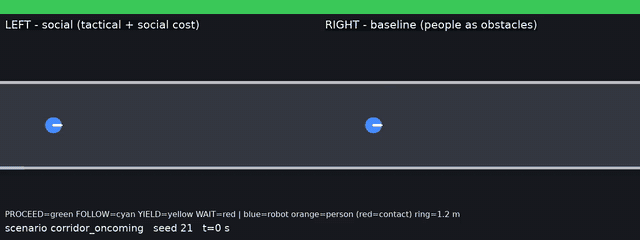
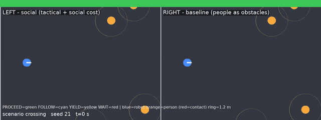
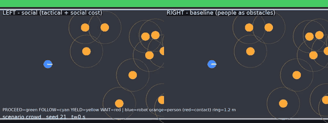
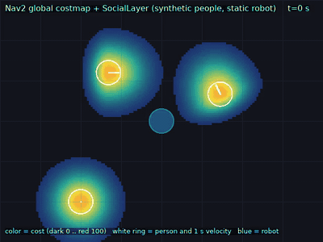

# 動作の様子

簡易シミュレータでの比較と、Nav2 の costmap 上の SocialLayer を GIF で示す(Release ビルド)。どちらも実機ではない。

## シミュレータ

- 左: social(戦術層 + ソーシャルコスト)
- 右: baseline(`--no-tactical`。人を障害物として扱う)
- シードは 21(判定用範囲の先頭。選り好みはしていない)
- 上部の色帯は、左のロボットの戦術状態を表す(PROCEED=緑、FOLLOW=シアン、YIELD=黄、WAIT=赤)
- 青がロボット、橙が歩行者(赤は接触中)。輪は半径 1.2 m のパーソナルスペース
- 再生成は `tools/make_sim_video.sh`(mp4、93 s)。GIF はそれを間引いたもの

### 対向(corridor_oncoming)

廊下で、正面から来る歩行者とすれ違う。このシードでの接触は、social が 0 回、baseline が 2 回(M1a)。

### 交差(crossing)

進路を横切る歩行者に対する振る舞い。このシードでの接触は、左右とも 0 回。

### 群衆(crowd)

多数の歩行者の中を抜ける。容量を抑えるため 4 fps に間引いた。

**このシードでは、左右とも歩行者に 5 回接触している。** どちらもロボットがほぼ止まったところに歩行者が当たったもので、走行中(0.05 m/s 以上)の接触は 0 回。

- social: 5 回とも、止まってから 1.0 s 未満(M1a)
- baseline: M1a が 4 回、1.0 s 以上止まった後(M1b)が 1 回

M1a の基準は回帰の上限(sfm2 の判定値で corridor_oncoming 31 以下、crossing 0、crowd 159 以下。ほかは 0)で、合格(後に歩行者モデルの切り替えで変更)。詳しくは [sim_results.md](sim_results.md)。

## Nav2 costmap 上の SocialLayer

Nav2 の global costmap と SocialLayer を rosbag に記録し、オフラインで描画した。

- ロボットは静止している。人は合成(往復・円運動・静止の 3 人)
- 動く人のコストの山は人に付いて移動し、進行方向側が膨らむ
- 動く人の速度は 0.25 m/s にしてある。SocialLayer は `max_speed_for_layer`(0.3 m/s)を超える人を描かないため(速い人は戦術層が扱う)
- 再生成は `ros2/social_nav_bringup/test/record_costmap_demo.sh`(手順は [bringup の README](../ros2/social_nav_bringup/README.md))

